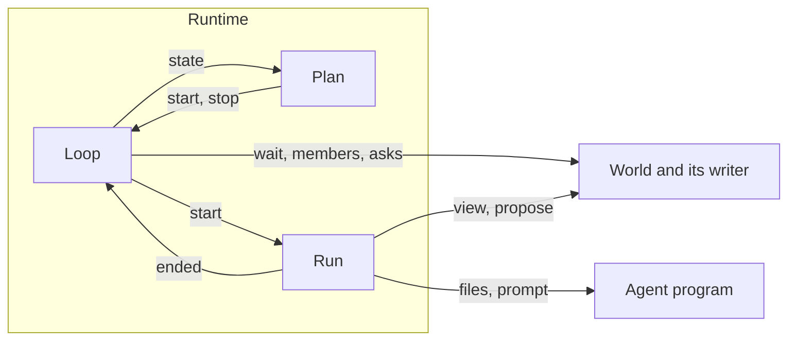

# Agent runtime

How agents run against a world. Why it is built this way: [runtime
vision](runtime-vision.md). Ponjo's doc world: [host spec](host-spec.md#buddies).
What an agent program gets and returns: [agent config](agent-config.md).

| Word | Means | In Ponjo |
| --- | --- | --- |
| member | a person or an agent | |
| agent | an AI member: an id and a prompt | a buddy |
| agent program | the tool that does an agent's thinking | an agent |
| world | the state the members share, and its rules | a doc and its comments |
| writer | the only part of a world that changes its state | the doc's door |
| ask | a request from a person that names an agent, open until it answers | a comment that @mentions a buddy |
| watch | a person's standing request: run this agent when its view changes | Watch this doc |
| run | an agent program working once for one agent | |

## Parts



| Part | Does | Never |
| --- | --- | --- |
| Loop | waits until the world changes, a run ends or a deadline passes; reads the world; applies the plan | decides who runs |
| Plan | a pure function: state → whom to start and stop, when to look again, and why for each agent | reads a file or a clock |
| Run | one agent, once: its view in, the agent program, a proposal out | changes the world, or starts a run |
| World | answers the five calls below, and says how its views compare and settle | knows about runs |

## The world's five calls

```
members()                           who is here: id, name, person or agent, may ask
asks()                              open asks: id, agent, from whom, when it asked, when it last
                                    changed; an agent's ask also for whom and how deep
view(member, { since, asks })       what this member sees: files, a prompt, the version
wait(version, deadline)             block until something changed after version, or the deadline;
                                    → the new version and the log since: version, author (a person,
                                      an agent or the world itself), time, whether only what is
                                      asked changed, whether it leaves watch runs stale
propose(member, version, old, new)  → landed, or refused because …
```

And what only the world can say of its views: a view's fingerprint
(`print`), whether a view holds what a run said wakes it (`wakes`), how
deep agents may wake each other (`limits`) and how long people's changes
pause before a watcher runs (`settleMs`). The contract, each value's
fields: the top of `src/core/runtime.js`.

- `wait` is the only place the runtime waits. It takes no callbacks, so no
  event can be lost: it asks what changed after a version, and the log
  answers.
- `view` is all a run is given. The prompt is built from the view alone.
- `propose` is the only way a run changes the world. The writer lands it
  under the world's rules (a doc merges; a game refuses a stale move), in
  order with every other change.
- Who may ask is the world's to say (`mayAsk`), and what an ask is: a
  comment that @mentions a buddy, a player's turn. The runtime knows no
  levels; it starts work only for those the world says may ask.

## How the plan decides

An agent is due when it is not running and either:

- **Asked:** an ask names it that is newer than the last one it was given,
  and has not failed. An agent's ask to another agent counts against the
  chain limit and runs for the person who started the chain.
- **Watching:** a person's watch is on, its view changed since its last
  run started, and the change is ready: a person's once they pause (the
  world's `settleMs`), the world's own at once, another agent's once that
  agent's run has ended. Its own change never counts. A run may name what
  it waits for (in Ponjo, lines of the doc); until its next run, only
  those wake it.

A change the world calls stale ends the runs only a watch started: they
saw an old view. In Ponjo a person's edit is stale, a file written outside
the app is not.

**Limits** keep the board coming to rest. A change by a person or the world
has depth 0; a run woken by an agent's change has that change's depth plus
1, and past a limit nothing wakes. Past a number of runs in a window, the
runtime pauses the board's watches and tells a person.

## A run

1. Get the agent's view, and note that it looked at this version.
2. Give the files and the prompt to the agent program, in a private folder.
3. Propose what it left behind, based on the version it saw.
4. Note how it ended. The loop looks again.

A run changes nothing itself, so it can be stopped, refused or lost at no
cost. An action on the outside world (a message, a deploy) belongs in the
proposal, for the world to carry out once ([outside
actions](#outside-actions)).

## Refused and failed

- **Refused:** the world turned the proposal away (the board moved on, or
  the move is not allowed), and nothing landed. The refusal is the world's
  own change, and what comes of it is the world's: it says why in the
  agent's next view and asks again, or plays its fallback (a game, a
  default move after 3 refusals). An ask made again because of a run's
  proposal carries that run's depth, so a world that keeps refusing comes
  to rest at its depth limit. The runtime has no notion of a refusal: the
  ask again is newer than the one the run was given, so the agent is due.
- **Failed:** the program exited with an error, timed out or could not
  start. Nothing lands. It is shown with Retry and never run again on its
  own: an agent is slow and costs money.
- **A failed read of the world** is tried again, later each time (1 s up to
  30 s).

## Outside actions

An action on the outside world (a message, a call to an API, a deploy) is
part of a proposal, never something a run does itself.

- **Proposed.** A run lists its actions next to its other changes, each
  with the action's name and its input. Only actions the owner installed on
  this machine can be named; the prompt lists them. Nothing in the world
  can install one.
- **Carried out once, after it lands.** An action exists only once its
  proposal lands; a run that is refused, redone, stopped or failed leaves
  none. Each landed action gets an id and a record on this machine:
  proposed, approved, started, then done or failed. The record is never in
  the world's shared state: shared state is data.
- **Never twice on its own.** An action that started and did not end (the
  host stopped) is not started again: it shows as "may have run", with
  Retry for a person. The action is given its id, so a service that takes
  an idempotency key drops a second try.
- **Approved first.** Each action asks the owner first, by default. Only the
  owner approves, as it runs on the owner's machine with the owner's keys;
  others see it waiting. The owner may set an action to run without asking,
  and then only for runs the owner started. Who approved and when is
  recorded with the action.
- **Its result** joins the world as the action's reply, at the depth of the
  run that proposed it plus 1, so agents cannot loop through the outside
  world.
- **Not undone.** Undo takes back the edits the action came with, never the
  action.

Reading stays with the agent program: its folder, the project, the web.
What it reads can end up where others see it, and a fetch can carry data
out in its URL. So the shipped agent programs are set to read, edit, search
and fetch only: no shell and none of the person's own tool servers.
Whatever a person adds to their script or their program's config can act
outside unchecked, and the guarantees above hold only for actions that are
proposed.

In Ponjo: an action is a plugin in `actions/` of the config folder, a
program and a manifest, as an agent is; it gets its input on stdin and its
id as `PONJO_ACTION_ID`. A run lists its actions in `PONJO_ACTIONS`, each
on one of its comments, and the record is in `logs/actions.jsonl`. The
action shows under its comment with what it does, its input, and Approve
and Decline for the owner; its result is a reply in that thread. Settings >
Actions lists them, each with Ask first (on by default).

## State

All in memory on this machine; nothing in a shared file, so no shared file
can make this machine run anything. Per agent: the asks it was given, the
version it last looked at, its view's fingerprint then, what wakes it,
failures, and its watch (also kept in the config folder). Per world: the
runs going and the limits. A restart clears it: open asks run again.

## Agent log

The runtime tells its host what it does as events (`trace`), one format
for every world: each look, what set it off and each agent's verdict and
why (asked in which ask, whose change, still typing, at the limit, already
running), and which runs it started; a look that failed; each run's end,
how it ended and what landed; the breaker tripping. Only a run's end holds
the world's content (its view, what it made); the host keeps and shows the
rest as names, versions and ids. The fields: Event in `src/core/runtime.js`.
In Ponjo the host writes them as the agent log (Settings > Agents > Agent
log), and each run's end to the runs' log.

## Security

What the runtime holds to in every world. Who may ask, and what asks, is
each world's (in Ponjo: [host spec](host-spec.md#buddies)).

- Work starts only for a member who may ask: their ask, an agent's ask for
  them, or a watch they turned on. A run is proposed for them, and the
  world lands it as they may.
- A run sees only its member's view and changes only through `propose`.
- Outside any view: whoever runs the host can read its files, and an agent
  program must be kept by its own permissions from opening files outside
  its folder.

## Today

What the code does differently from the runtime above:

- One runtime per open doc (`src/host/open-doc.js`); it stops when the doc
  closes.
- Every member sees the whole doc and every thread; in project mode the
  agent program may read the project folder.
- Nothing is refused: the doc world merges.

Code: the loop is `src/core/runtime.js`, which reaches nothing but the world
and what its host gives it, so it can run in a Worker too; the plan
`src/core/due.js`. On the doc host, `src/host/buddy-runtime.js` gives it the
run (`src/host/runner.js`), the logs and the settings; the doc world `src/host/doc-world.js`, its
asks `asksIn` (`src/core/comments.js`) and its prompt `src/core/prompt.js`.
