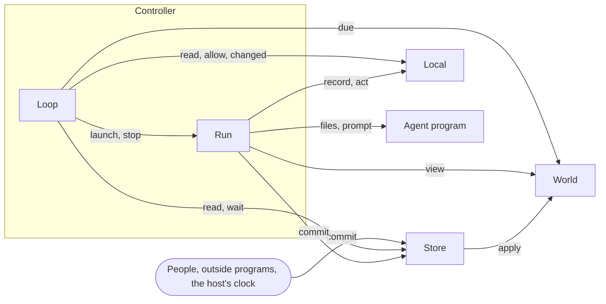

# Blackboard Agent Runtime

How people and agents work on one shared state. Why it is built this way:
[vision](runtime-vision.md). Ponjo is one application built on it
([Ponjo](#ponjo)).

| Word | Means |
| --- | --- |
| member | a person or an agent |
| agent | an AI member: an id and a prompt |
| agent program | the tool that does an agent's thinking |
| host | the application that runs the runtime: it gives it a store, local, a world and an agent program |
| owner | the person whose machine runs the host, with their keys |
| world | the rules: who is due, what each member sees, what a change does |
| store | where the world's state is kept, and the one way it changes |
| local | what only the owner's machine knows and allows |
| controller | what waits for changes and starts and stops runs |
| task | one agent, due for some people, given some things to answer |
| run | an agent program working once on a task |

## Components



| Component | Does | Never | Why it stands alone |
| --- | --- | --- | --- |
| Store | keeps the shared state; lands every change, one at a time | decides a rule | the state can move (a file, a database, a remote object) and no rule changes |
| Local | keeps what only the owner's machine may say: who asked for work, what it may spend; carries out outside actions | keeps shared state | anyone who reaches the shared state can write it, so what makes this machine spend comes only from what this machine writes |
| World | three pure functions: who is due, what a member sees, what a change does | does I/O or reads a clock | a rule is a function of the state: tested alone, the same answer at every look, safe to apply again |
| Controller | waits, starts and stops runs, commits what they made | decides who is due | one mechanism for every world |

The agent program is the host's: the controller calls it, and knows only
its answer.

## Store

```
read()               → { rev, state }
wait(rev, deadline)  → rev        once the state has moved past rev, or at deadline
commit(change)       → { rev, actions } | { refused: why }
```

- `read` returns one snapshot: `state` is the state at `rev`, whole.
- `commit` is the only way the state changes, for everyone: a person, an
  outside program, a run, the host's clock. It applies the world's `apply`
  to the newest state and lands the result only if the state has not moved
  meanwhile; if it has, it reads again and applies again. Changes land one
  at a time, each at a higher `rev`.
- `rev` is kept with the state and only grows.
- `wait` returns on any change after `rev`. Its return carries nothing:
  the caller reads again, so a lost or doubled notice costs nothing.

A change names who made it (`by`: a person, an agent or the world) and is
otherwise the world's. A run's change is `{ by, for, given, depth, base,
made }`: the people it ran for, what it was given, its depth, the files it
was given, and what it left (`made`), which may be nothing or `{ failed }`.

*Why.* These four properties (one snapshot, a write on a condition, a
growing version, a wait) are all the controller and the world need. So a
store can be a file held by one process, a database (a transaction;
`WHERE rev = ?`; notify or poll) or a remote object (its version; `If-Match`;
a webhook or poll). Only the store changes when the truth moves.

## Local

```
read()          → what this machine vouches for
changed()       → once that changes, or a run ends
allow(task)     → whether this machine lets the task start
record(change)  → notes a change a run will commit, before it is committed
act(actions)    → each action that landed: recorded, approved, carried out once
```

- Only this machine writes local. Nothing in the store can.
- It holds what makes this machine spend or act: who turned on which watch,
  which changes this machine's runs made and for whom, the settings, the
  record of each outside action, and the limits.
- `allow` is the limits. A task a person or the world set off has depth
  0; one only an agent's change set off, that change's depth plus 1. Past
  the depth limit nothing starts, so agents waking each other come to rest.
  Past `pauseAfter` runs within `pauseWithin` minutes (the breaker),
  standing tasks stop starting until a person resumes them, so a loop the
  depth cannot see, such as a program that echoes an agent, stops too.
- Writes come before what they cover: a run is counted before it starts,
  and `record` comes before `commit`. A crash between the two leaves a run
  counted that never ran, or a record of a change that never landed: both
  harmless.

*Why apart from the store.* Trust is about who can write, not who can
read. A private part of the store is still written by whoever reaches the
store: a teammate, `git pull`, an outside program. If a forged entry could
make this machine spend or act, the entry belongs in local.

## World

```
due(state, local)            → [Task]
view(state, local, task)     → { files, prompt }
apply(state, change, local)  → { state, actions } | { refused: why }

Task  { agent, for, given, depth, standing, why }
```

`for` the people the task runs for; `given` the ids of what it answers
(asks, a watch); `standing` whether only a person's standing request (a
watch) makes it due; `why` in words, for the agent log.

- **Pure.** No I/O, no clock, no randomness of its own. What comes from
  outside comes in a change: the time people paused, as a change the host's
  clock commits; a dealt deck, as the dealer's change.
- **From state.** `due` is a function of the state and local: the same
  inputs, the same tasks. An agent is due while something it was given is
  newer than what it last answered.
- **Every run's change lands.** `apply` records each run's change, also one
  that made nothing or failed, as what that agent has answered, so `due`
  stops listing it. Nothing about who is due lives elsewhere: a restart
  changes nothing.
- **Policy from the state, trust from local.** `due` lists a task only for
  people local vouches for: who may ask, who turned on the watch, which
  agent's change asks on whose behalf. The shared state decides what is
  due; it never decides whom this machine spends for.
- One task per agent, and the ids in `given` stay the same from one look
  to the next.

*Why pure.* A rule that is a function of a snapshot can be tested with no
host, gives the same verdict at every look, can be applied again when a
commit meets a newer state, and does not care where the state is kept.

## Controller

```
loop:
  { rev, state } = store.read()            on failure: wait(rev, now + backoff), 1 s up to 30 s
  vouched = local.read()
  tasks   = world.due(state, vouched), each one local.allow lets start
  stop each run none of whose given is in tasks
  launch each task whose agent is not running
  wait until store.wait(rev) or local.changed() returns

launch(task):
  view   = world.view(state, vouched, task)
  answer = program(task, view, signal)     ok (made) | failed | stopped
  unless stopped: local.record(change); { actions } = store.commit(change); local.act(actions)
  the run ends; local.changed() returns
```

- An agent has at most one run. A change it was not given waits for its
  next run.
- A run that is stopped commits nothing; the world still lists what it
  was given, so it runs again when that is due again.
- The loop waits on `rev` as it read it, so a change that lands while it
  works makes the wait return at once.
- It holds only the runs going. Losing them loses at most their work.

The controller tells the host what it does, as events (`trace`): each look,
each task's verdict and why; a look that failed; each run's end, how it
ended and what landed. Only a run's end holds the world's content (its
view, what it made).

*Why so little.* Everything that differs from world to world (what an ask
is, when a change is ready, what a member sees, what lands) is the world's;
everything that must be trusted is local's. What is left is the same for
every world: wait, start, stop, commit.

## Outside actions

An action on the outside world (a message, a call to an API, a deploy) is
part of a run's change, never something a run does itself.

- **Proposed.** A run lists its actions in what it made, each with a name
  and an input. Only actions the owner installed on this machine can be
  named; the prompt lists them. Nothing in the store can install one.
- **Carried out once, after it lands.** `apply` returns the actions of a
  change that landed; a change that is refused, or a run that is stopped,
  carries none. Local gives each an id and a record (proposed, approved,
  started, then done or failed), never in the store.
- **Never twice on its own.** An action that started and did not end is
  shown as "may have run", with Retry for a person. It is given its id, so
  a service that takes an idempotency key drops a second try.
- **Approved first.** Each asks the owner first, by default. The owner may
  let an action run without asking, and then only for tasks the owner alone
  is `for`.
- **Its result** is committed as the action's reply, one deeper than the
  run that proposed it, so agents cannot loop through the outside world.
- **Not undone.** Undo takes back the edits it came with, never the action.

Reading stays with the agent program: what it reads can end up where
others see it, and a fetch can carry data out in its URL. So the shipped
agent programs read, edit, search and fetch only. The guarantees above
hold only for actions that are proposed.

## Security

- Work starts only for people local vouches for, and a run's change lands
  as they may.
- A run sees only its task's view and changes the state only through
  `commit`.
- Outside any view: whoever runs the host can read its files, and an agent
  program must be kept by its own permissions from opening files outside
  its folder.

## Ponjo

Ponjo, a text editor where people and buddies co-author files, is a host.
Its rules for a doc are in the [host spec](host-spec.md#buddies); what an
agent program gets and returns, in [agent config](agent-config.md).

| Here | In Ponjo |
| --- | --- |
| agent | a buddy |
| agent program | an agent (`agents/`, run by `src/host/runner.js`) |
| world | the doc world (`src/host/doc-world.js`); three games in `preview/` |
| store | the doc's door (`src/host/doc-service.js`) |
| local | the config folder: settings, watches, logs |
| controller | `src/core/runtime.js`, given its runs, logs and settings by `src/host/buddy-runtime.js` |
| an outside action | a plugin in `actions/` of the config folder, a program and a manifest; its input on stdin, its id as `PONJO_ACTION_ID`, its record in `logs/actions.jsonl` |

## Today

Ponjo's code (`src/core/runtime.js`, `src/core/due.js`) is the design
before this one, and so are its doc world's rules in the host spec:

- The world is one object of five calls with I/O (`members`, `asks`,
  `view`, `wait`, `propose`); the plan, who is due, is the controller's
  (`due.js`), and the world adds `print`, `wakes`, `limits` and `settleMs`.
- Who is due rests on notes in memory (asks given, failures, each watcher's
  last look, fingerprint and wake lines), and the doc world keeps in memory
  which comments its runs posted. A restart drops them: open asks run again.
- A run that makes nothing or fails commits nothing; a failure is noted in
  memory, with Retry.
- Time is in the plan (`now`, people's pause) and in the breaker, kept by
  the controller; a look is set off from several places, one at a time.
- A run stops only when its agent is no longer due at all.
- The doc world reads the comments, the settings and the actions from disk
  itself, beside its door.
- The game worlds (`preview/poker-world.js`, `preview/werewolf-world.js`,
  `preview/spy-world.js`) change their table in place and read the clock.
- One controller per open doc (`src/host/open-doc.js`); it stops when the
  doc closes.
