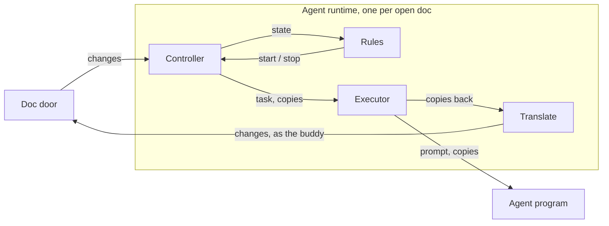

# Agent runtime

How buddies run against a doc. It uses only the doc's public door
([architecture](architecture.md#the-door)), as any client does; the doc
knows nothing about buddies.

Code: the controller is `src/host/buddy-runtime.js`, the executor
`src/host/runner.js`, the rules `src/core/due.js` (with the steps in
`src/core/bucket.js`), Translate `src/core/translate.js`.

## Principles

| Principle | How the runtime follows it |
| --- | --- |
| **A client like any other.** The doc knows nothing about buddies. | The runtime reads the doc, listens to its changes and writes through the same door as a window, as the buddy. It has no other way in. |
| **Decide from state, not from events.** | The controller never acts on an event. Any change, timer or finished run only makes it look again: read the state, ask `plan`, start and stop runs. A missed event costs nothing, and a restart loses nothing that matters. |
| **The agent is a filter.** | The executor gives the agent copies in a temp folder and a prompt, and reads the copies back. Any command-line agent works, and none can touch the real files. |
| **Only people start work.** | A run needs a person's ask, or a watch a person turned on. Only comments that came through the door can ask. Buddies waking each other spend steps from a small budget. |
| **Runtime state stays on this machine.** | Notes, failures, steps and running runs are in memory; the watch list is in the config folder. Nothing is written to a shared file, so a shared file can never make this machine run something. |
| **An agent is costly: people decide.** | A failed run is shown with Retry, never retried on its own. Every change a buddy makes is a group, undone with its comment. |
| **Pure where possible.** | Rules and Translate are pure functions, so most behaviour is tested with no agent and no waiting. |

## Overview



## Components

| Component | Does | Interface |
| --- | --- | --- |
| Controller | holds the runtime's state; hears each change; one timer | `changed(by)`, `look()`, `statuses()`, `watch`, `retry`, `refillSteps`, `close()` |
| Rules | pure: decides what should run now | `plan(state)` → `{ start, stop, steps, wakeAt }` |
| Executor | runs the agent once on copies in a temp folder | `execute({ task, copies, agent })` → the copies back |
| Translate | pure: turns the agent's copies into door changes | `toChanges({ base, edited, comments, groups, threads })` → `{ posts, carried }` |

## State

All in memory, on this machine only. Never written to the shared files.

```
per buddy:  seen     thread → time of the last comment its runs were given
            lookedAt rev its last run started at
            base     the doc as its last run started
            failed   thread or watch → why
            watch    { by } or null (also noted in the config folder)
per doc:    changedAt  author → rev (and time) of their last change to the text
            steps      budget for buddies waking each other
            running    buddy → run
```

## How it decides

The controller is level-triggered: it never acts on an event itself. Any
change, timer or finished run only means "look again":

```
look():
  state = the doc (door) + notes
  { start, stop, steps, wakeAt } = plan(state + notes, now)
  stop the runs in stop, start the runs in start
  set the one timer to wakeAt: people's pause ending, the next step
```

A look at any time gives the same answer, so a missed event costs nothing.

`plan` starts a buddy when:

- **Ask:** a person's comment names it and it has not replied after it.
- **Watch:** a person turned on its watch, and since its last run people
  changed the doc and paused 5 s, or another buddy changed it. A buddy's own
  change never counts. A run woken by another buddy costs one step.

## A run

1. Executor copies the doc and its comments to a temp folder and starts the
   agent with a prompt on stdin.
2. The agent edits the copies and exits.
3. Translate diffs the copies: new comments, each with its group of edits,
   merged by line with the doc as it is now.
4. Controller submits the changes through the door, as the buddy, with the
   level of the person who asked.
5. Controller updates the buddy's notes and looks again.

## Failure

- A failed run lands nothing and is shown on the buddy with Retry. It is
  not retried on its own: agents are slow and cost money.
- A failed read of the doc is retried with backoff (1 s up to 30 s).
- A restart clears the notes; unanswered asks run again.

## Security

- Only people start work: an ask comes from a person allowed to write, and
  only through the door. A comment found in the file asks no one.
- The agent sees copies only, plus read access to the project folder.
- Buddies waking each other is bounded by steps.
