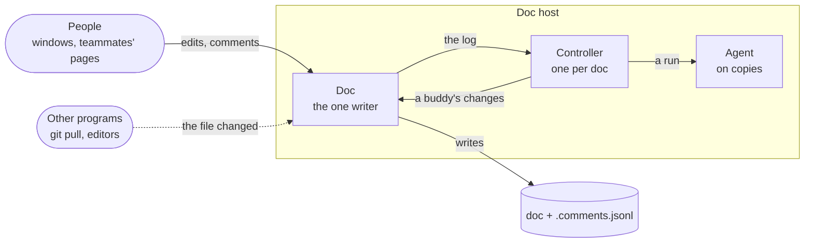
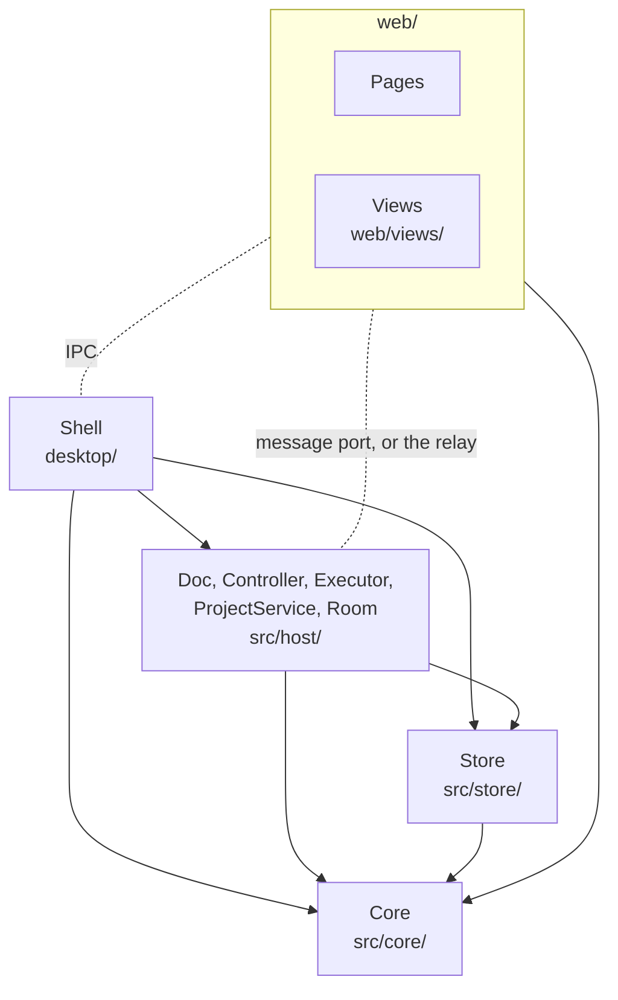

# Architecture

How Ponjo is built. Product: [product vision](product-vision.md); what a
person sees and does: [user experience](user-experience.md); the comment
format: [SPEC](../spec/SPEC.md); tests: [testing](testing-ci.md).

This is the design the code moves to. Not built yet: the buddy runtime as
[Buddies](#buddies) describes it (today `src/host/doc-service.js` also
holds the buddies' notes, timers and landing, and comments are versioned
apart from the text), and `teammate`, which the code still calls `player`.

## Overview

People and AI buddies write the same files together. One process on the
owner's machine, the doc host, holds each open doc and does every write to
it, whoever the change is from: a person in a window or a browser, a buddy,
or another program. A buddy is run by an agent, a program that edits a
copy of the doc and appends comments to a copy of its comments.



### Words

| Word | Means |
| --- | --- |
| member | anyone who changes a doc: a person or a buddy. Every change has one as its author; a file changed outside is by `outside` |
| person | a human member: the owner, or a teammate |
| owner | the person whose machine holds the files and runs the doc host |
| teammate | a person who joined the owner's room from its link |
| buddy | an AI member: an id, a name and a persona, in one file. It has no code and no state |
| agent | the program that does every buddy's work, picked in Settings > Agents |
| run | the agent working once as one buddy, on copies of one doc |
| ask | a person's comment that names a buddy, open until the buddy comments after it |
| watch | a buddy set by a person to run when the doc changes |

The code says turn nowhere: a buddy answering is a run.

### Principles

1. **Files are the truth.** Docs, their comments and buddies are plain
   files. Everything else is a cache rebuilt from them, or only costs undo
   if lost. What runs on this machine (runs, failures, watches, steps) is
   this machine's and never written to a shared file.
2. **One door, one writer.** Every change, whoever makes it, comes through
   the doc's one door, in one order. An agent gets only copies. A change
   made outside (another editor, `git pull`) is seen and merged.
3. **No one resolves a conflict by hand.** An edit merges by how it comes,
   not by who made it: typing by character, so nothing typed is lost; a
   whole text that arrives late (a run, an outside change, an undo) by
   line, where the doc's lines win. What does not land can be asked for
   again or found in history.
4. **Every change can be undone**, a buddy's with the comment it came with.
5. **Only a person starts work.** A buddy runs on a person's ask or a
   person's watch. Buddies wake each other only within the doc's steps.
   Nothing in a shared file makes a buddy run, or chooses what program
   runs, on this machine.
6. **Decide from state, not from events.** What should run is worked out
   from the doc and this machine's notes whenever anything may have
   changed; an event only says when to look. A look at any time finds the
   same, so a missed event costs nothing.
7. **An agent is a filter**: a prompt on stdin, copies in, copies out. It
   knows nothing of Ponjo and remembers nothing. It is slow, costly and
   not sure to agree with itself, so a run that fails is shown to people,
   not tried again on its own.
8. **One part does one thing, through the fewest calls.** If it takes two
   sentences to say what a part does, it is two parts. A new call is the
   last resort.
9. **Never take mutable state as the truth.** Join things by a stable id;
   a name, a path or a color is an alias, kept for show. A buddy is its
   id, not its name.

## Data

| File | Where | Holds | Is |
| --- | --- | --- | --- |
| a doc | anywhere; in a project, under its folder | the text | shared truth |
| its comments | beside it, `<doc>.comments.jsonl` ([SPEC](../spec/SPEC.md)) | threads, anchored on the text | shared truth |
| a project's buddies | `.ponjo/buddies/<name>.md` in the project ([PROJECT](../spec/PROJECT.md)) | each buddy: its id, its persona | shared truth |
| the user's buddies | `buddies/` in the config folder | the same, for every doc | this user's |
| `settings.json` | config folder | the user's id and name, editor and views' settings, the agent picked and its settings | this user's |
| `agents/` | config folder | each agent: a program and its manifest ([agent config](agent-config.md#agents)) | this user's |
| `secrets.bin` | config folder | agents' secret settings, encrypted with the system keychain | this user's |
| `state.json` | config folder | recent docs and folders, window bounds | cache |
| `history/<doc>/` | config folder | the doc's versions; the window edits its file was last written with; the comments this host took; the buddies watching it | this machine's |
| `logs/` | config folder | `runs.jsonl`, a line per run; with Trace runs on, `traces/<run>.json` | this machine's |

The config folder is `~/Library/Application Support/Ponjo/` on macOS. Only
the app writes it. Every file is written whole: a temporary file in the
same folder, with the file's permissions, renamed over it.

Above the files, a doc is its text: UTF-8, no byte order mark, lines ending
in `\n`. Its byte order mark and each line's end are put back when it is
written, a new line ending as the line before it. A file that is not UTF-8
does not open.

**Doc mode and project mode.** A `.md` file opened on its own (from Finder)
is doc mode: one doc, the user's buddies, no room. A folder opened from the
home page is project mode: a file tree, the user's buddies and the
project's, and a room to share. A project's buddy wins over one of the
user's with its name; name, face and color follow one rule ([PROJECT
§2](../spec/PROJECT.md)). The first start writes the user's first buddy,
Clippy.

## The doc

### The door

Every call to a doc comes as `call(type, arg, who)`, `who` being `{ id,
name, kind, level }`, set by the host from the connection and never taken
from a message. A connection is bound to one doc, so no call names one.
Each call needs a level, `read < write < owner`; `can(who, level)` lets it
through, once, and nothing behind it checks again.

| Calls | Level |
| --- | --- |
| `state`, `history`, `version`, `cursor`, `image`; the project's `list`, `read`, `open` | read |
| `submit`, `comment` (resolving and reopening too), `undo` | write |
| everything else: `move`, settings, buddies, agents, `saveImage`, the room's own calls | owner |

The owner's level is owner, a teammate's read or write. A buddy acts with
the level of whoever asked it, at most write, as a Unix program runs as the
user who started it. Behind the door, `who` only names a change's author.

Events to every connection on the doc: `change` (each change in the log,
below), `saved` (whether the file holds what was told, and why not),
`cursors`, `missing` (the file gone), `renamed`, and from the controller
`buddies` (who is here, running, watching, failed; the steps).

### The log

Every change to a doc is a line in one ordered log, in memory: `{ rev, by:
{ id, kind: person | buddy | outside }, at, edit? | comment?, group? }`.
An `edit` is insert and delete operations, offsets in UTF-16 code units of
the doc's text; a `comment` is a comment line ([SPEC](../spec/SPEC.md));
`group` the comment an edit hangs on, to undo with it. `rev` counts the
changes since the host opened the doc, which `epoch` names; one `rev`
versions the text and the comments, so whether anything changed since a
moment is a comparison of two numbers.

A window's edit is operations on the `{ epoch, rev }` it started from.
The door transforms them over what landed since, by character
(`transform` in `src/core/ot.js`), lands them, writes the file, and only
then tells everyone. A whole text (a run, an outside change, an undo) is
merged by line first (below) and lands as an edit on the current `rev`,
like anyone's.

Only a comment that came through the door by a member asks: one found in
the file is by `outside` and asks no one. The comments this host took are
noted in the doc's history, so this holds after a restart.

### How edits merge

| Edit | Comes as | Merged | Where it collides |
| --- | --- | --- | --- |
| a window's: typing, a paste, a cut | operations on the rev the window last heard, milliseconds old | by character (`transform`) | both stay, in the order they reached the host |
| a whole text: a run, an outside change, an undo | the text it ended on, from a base that may be minutes old | by line (`merge3(base, doc, late)` in `src/core/diff.js`) | the doc as it is stays; the late text is in history |

An edit from a window says what it does, on text its writer saw a moment
ago, so it moves over others' by character. A whole text says only where
it ended: its operations are a diff's guess, and spliced by character into
edits it never saw they make words no one wrote. By line, the collision
shows. The doc as it is wins because people have seen it and keep working
on it, while a late text can be made again or found in history. So a
paste, however large, is a window's edit, and a person's edit saved in
another editor gives way where it collides, as a run does.

### Files on disk

The door reads the doc and its comments when the doc opens, keeping a
hash of each, and watches both: a folder watch, and a poll every 500 ms for
file systems where watches miss changes. A doc file it did not write is a
change by `outside`: taken once unchanged for 50 ms (up to a second), as
another program may be half way through writing it; saved to history; then
merged by line from the text the file last held, and landed. Before each
write it checks the file is still what it last wrote, and lands an outside
change first. A file whose size, mtime and inode are those of its own last
write is not read again: a doc of millions of characters takes tens of
milliseconds to read and hash.

A write that fails (a read-only file, a lock, a full disk) does not undo
the edit: it has landed, `submit` answers `not_saved`, and the door writes
once it can, half a second later, then twice as long each time up to 10
s. Every connection hears whether the file holds what it was told
(`saved`), so a page shows Not saved, and why, exactly while it is so.

### Catching up

A window catches up one way, whatever it missed (a new connection, a missed
event, an edit refused as `stale`): `state({ since: { epoch, rev } })`.
While the log reaches back that far (the last 1,000 changes), the answer
holds the changes missed, and the window takes them as any, knowing its own
edit by its id. For a new epoch (the host started again) or a log that no
longer reaches back, it takes `diffOps(the text it last heard, the new
text)` and moves its typing over that. An edit lands at most once: one
sent again with the same id and rev is answered with the rev it already
made, however long ago, as the ids written to the file are noted in the
doc's history through every restart. A whole text needs no log: each has
its base (a run's copy, the file's last text, a version).

### Versions and undo

History records a version each time typing pauses (its authors each person
who typed), before and after each buddy's group of edits, an outside
change, an undo and a restore, each credited to who made it. A version
never changes: it names its `parent`, and only the oldest go once the
history is full.

An undo is one edit: a version's change taken back, from its parent's text
to its own, merged by line with everything since (`merge3`), so lines
someone changed since stay. Three ways, each saving a version first:

1. Cmd+Z: the editor's own history, a person's own typing, mapped over
   others' edits. Its result is typing, merged by character.
2. Undo on a buddy's comment: the edits of its group, and no other
   comment's; then Redo, which undoes that undo.
3. Undo in history, for a version or a row of them, whoever made it; or a
   restore, a `submit` back to an old version's text.

### Editing

What a person can count on when they edit, alone or with others. To a
person, another writer is one of three: a teammate, a buddy, or an outside
program. Editing alone always has the last two, so alone is the case of one
person. Every rule holds for any number of people and any kind of other
writer: there is one path for everyone (page → `web/client.js` → the door),
and one set of tests covers it all, by parameters
([testing](testing-ci.md#editing-tests)).

**Scope.** Docs within the views' limits (below); up to 8 people editing at
once; a one-way network delay up to 150 ms. Past it editing may be slower,
but the A rules always hold and the person is told.

**A. Data**, with no tolerance:

| Id | Rule |
| --- | --- |
| A1 | Converge: once writers stop, every page's text is the host's text is the file. |
| A2 | Nothing lost: what a person typed and nobody deleted ends up in the file, through crashes, power loss and dropped lines. |
| A3 | Nothing twice: an edit lands at most once, through resends, restarts and write failures. |
| A4 | Typing is never merged away: a window's edits (typing, a paste) merge by character, and nothing typed is lost. A whole text that arrives late (a run, an outside change, an undo) merges by line with the doc as it is when it lands: where both changed the same lines, the doc's lines stay, and the late text can be found in history. A window's edit on its way when one lands moves over it by character, as over anyone's. |
| A5 | Text intact: no split surrogate pair, no U+FFFD; each line's end (LF, CRLF, CR), the BOM and the file's permissions kept; unchanged blocks saved byte for byte. |
| A6 | Shown is saved: whatever the page shows as saved is in the file; anything not saved is marked, with the reason. |

**B. Latency**, median and p95, the network aside, within the limits. The
numbers are `LATENCY` in `web/views/index.js`, which the tests read:

| Id | From | To | Within |
| --- | --- | --- | --- |
| B1 | the doc opened | an editable view | 3 s |
| B2 | a key | its character on screen | 30 ms, 100 ms |
| B3 | a key | its character in the file | 50 ms, 100 ms |
| B4 | another writer's edit arriving | it shown | 50 ms, 100 ms |
| B5 | a key | its character shown at a teammate | 50 ms, 100 ms |
| B6 | a person's cursor moving | it shown at the others | 100 ms p95 |
| B7 | the doc opened | the end of any one task that keeps the page busy | 500 ms |
| B8 | a file clicked in the sidebar | its doc drawn in place of the one before, for a doc of everyday size | 500 ms median |

**C. Recovery:**

| Id | Rule |
| --- | --- |
| C1 | Crash: killed and opened again, everything shown as saved is there; no file is half written. |
| C2 | Close: typing not landed lands before a window closes. |
| C3 | An outside change while typing: my text stays; the outside version goes to history. |
| C4 | A write that fails (a read-only file, a lock, a full disk): the page says Not saved, and why. Once the file can be written, the typing is saved, exactly once. |
| C5 | Reconnect: within 5 s of the line or the host coming back (30 s for a host waking from sleep), the page has caught up on text, comments, cursors and level. A window of the app whose doc host started again saves the typing done meanwhile, once; a teammate's page saves nothing typed before its line dropped (C6). |
| C6 | Line down: a teammate's page whose line drops, a half-open socket included, is read only at once and says so within 15 s; typing not sent then is shown as it was left, to copy (as in C7), never sent later. It edits again once caught up on the line made again, unless it shows such typing: then once reloaded. |
| C7 | Level: a level change applies within 2 s online, and on reconnect offline. Typing that can no longer be saved is never dropped silently: the page says so and shows that text, to copy. |
| C8 | Isolation: one page's bad request or oversized message never disconnects the others. A doc too big for the relay (`MAX_MESSAGE` in `relay/worker.js`, room for the Plain view's longest) does not open through sharing, and its page says so; an event that big is left out. |

**D. Editing**, whoever the other writer is:

| Id | Rule |
| --- | --- |
| D1 | My caret stays: others' edits never move my caret or selection off the character it is next to. |
| D2 | My viewport stays: when others edit above me, the line I am looking at keeps its place on screen. |
| D3 | My undo: Cmd+Z undoes only my typing, and still works after others split or restyle my paragraph. |
| D4 | IME: nothing is saved or sent mid-composition, and others' edits arriving meanwhile show once it ends (one in the text being composed would break it); they lose or double nothing. |
| D5 | The view never rewrites: after `applyText(t)`, `getText() === t`; a view's own normalisation is never saved as anyone's edit. |
| D6 | Clear marks: a teammate's typing shows only by their cursor; a buddy's change is flagged with its name; outside changes and restores glow. |
| D7 | Drafts stay: a comment being written, and its anchor, survive others' edits. |
| D8 | Comments follow their text: a thread stays on its text through others' edits, and through its buddy rewriting that text. |

**E. State:**

| Id | Rule |
| --- | --- |
| E1 | At any moment the page is in exactly one true state: Saved, Saving, Not saved (and why), Offline or Read-only. Alone too. The toolbar shows it (`paintSave` in `web/main.js`); other problems show apart, beside the doc's name. |

A view keeps the B rules only up to a size, its `limits`:

| View | Up to | Past it |
| --- | --- | --- |
| Markdown | 1,000,000 characters | opens as plain text, and says so; the person may choose the Markdown view anyway, for that window |
| Plain text | 5,000,000 characters | opens read-only, and says so |
| Plain text's colour | no block over 10,000 characters | the doc opens without colour |

The desktop app opens text files up to 20 MB, room for the plain view's
limit in any script. A view sends each change as it is made (`onEdit`),
one edit on its way at a time: keys typed meanwhile go out together once it
is answered, so typing reaches others while it goes on.

## Buddies

A buddy runs only on docs open on this machine, and only for a person: on
an ask, or while a person has it watch the doc. The doc knows nothing of
buddies: a controller, one per open doc, reads the doc and its log through
the door, decides what should run, runs the agent, and writes the run's
changes back through the door as the buddy, as a window writes a person's.

| Part | Does | Knows nothing of |
| --- | --- | --- |
| Rules (`src/core/`) | pure: `plan(...)` → what to start and stop, the steps spent, when to look next | files, clocks |
| Controller (`src/host/`) | keeps the notes, the steps and the runs; listens to the log; one timer | the doc's insides |
| Executor (`src/host/runner.js`) | `run(task, copies)` → the copies back | the doc |
| Translate (`src/core/`) | pure: a run's copies → the changes to apply | files |

### Asks and watches

**An ask.** A person's comment asks a buddy until the buddy comments in its
thread after it. A comment asks whom it @mentions; one that mentions no one
asks the thread's buddies: the one that opened it, and each @mentioned
there before. An empty one (resolving, reopening) asks no one. Only the
comments of those who may write ask (the owner, a teammate who can edit),
and only those the door took. Resolving a thread, which only people do,
drops what it asked. A comment a run was given asks no more, though the run
posted nothing there, until someone writes in the thread again: a buddy
that answers nothing is not run again and again.

**A watch.** A person sets a buddy watching the doc, or unsets it; nothing
the buddy or the app does changes it. It is noted on this machine, `{ by }`,
never in the comments, and the buddy runs as whoever set it may, while they
may ask. A watcher is due once set, then on another member's change since
its last run started: people's once they pause for 5 s (`SETTLE_MS`), a
buddy's at once, for it lands whole. Its own change never wakes it. A
person editing again while a run only a watch started is on ends that run
with no answer, for it saw the doc as it was. Each run is told what
changed since its last (`lineChanges`), and comments in its watch thread:
its open thread on the whole doc, worked out from the comments; with none,
it opens one.

**Steps.** So that buddies cannot wake each other for ever, a run woken by
another buddy's change takes a step from the doc's steps: up to 20, one
more a minute (Settings > Agents sets both; 0: only on Refill); with none
left, watchers wait. People's changes take none. The steps are this
machine's, in memory.

### The controller

The controller keeps, for each buddy here, its notes, on this machine
only:

```
{ seen: thread → the rev of the last comment its runs were given there,
  lookedAt: the rev its last run started at,
  failed: thread or "watch" → why,
  watch: { by } or null }
```

and, for the doc, who last changed it at which rev (`changedAt`, people as
one), the steps, and the runs going. It hears every change in the log: it
notes `changedAt`, and a person's ends the runs only a watch started. Then,
and whenever its one timer fires, it reads the doc and asks the rules:
`plan({ threads, rev, changedAt, notes, running, steps, now })` → `{
start, stop, spend, wakeAt }`. It starts and ends runs as told and sets its
timer to `wakeAt`: the soonest of people's pause ending, the next step
coming, and a failed read tried again (1 s, twice as long each time up to
30 s). The same look at any time finds the same; nothing else runs a
buddy. A buddy has one run at a time in a doc, given every thread that asks
it and it has not been given; a comment written while it runs is for the
next.

### A run

1. The executor copies the doc and its comments into a new private folder,
   at the doc's path in the project, which is how the prompt names them,
   and starts the [agent](agent-config.md) there with the prompt on stdin:
   who the buddy is, the other members, the rules, every thread that asks
   it, and for a watcher what changed. In project mode it is given the
   project folder to read; what it may read there is up to the agent
   ([permissions](agent-config.md#permissions)), and the folder holds no
   name starting with `.` the agent is shown.
2. The agent edits the doc's copy and appends its comments to the
   comments' copy, each comment's edits as a group
   ([groups](agent-config.md#groups)). A run with nothing to do changes
   nothing.
3. On exit 0, Translate turns the copies into changes: the new comments,
   each with its group of edits merged by line with the doc as it is now
   (`merge3`, the doc's lines win, the version says `conflict`). An agent
   that wrote no groups hangs its edits on its last comment, or on an empty
   reply in the first thread that asked it: no edit lands without a
   comment. A reply in a thread resolved meanwhile is dropped, with its
   edits; a line that would resolve is ignored, as only people resolve. In
   a thread that asked it, its comments come just after the last comment
   it was given, so one written meanwhile is after them, still to answer.
   The controller applies the changes through the door, as the buddy.
4. The private folder is deleted, and the run gets a line in
   `logs/runs.jsonl`: its id, doc, buddy, threads, the comments it posted,
   start, duration, outcome (`ok`, `failed`, `timedOut`, `stopped`) and
   exit code, and, when its agent wrote them, its tokens and model, which
   Settings > Usage sums. A log there past 10 MB keeps its newest half.
   With Trace runs on, it also leaves its trace (the prompt, the agent's
   steps, its output, the copies before and after, what landed) in
   `logs/traces/<run>.json`, the newest 200 kept, for the doc's Runs.

A run that is ended (its asks resolved, its watch unset, its buddy deleted,
a person typing while only a watch had it run) lands nothing. Runs of
different buddies go on at once; their changes land one at a time, in the
door's order.

### Failures

A run that fails (an exit other than 0, a timeout, a run the host could not
start) lands nothing and writes nothing to a shared file: a failure is this
machine's. It is noted in the buddy's `failed`, by thread or for its watch,
and shown on the buddy and the thread with Retry (`retry({ buddy })`); why
(the end of the output, the script) to the owner alone. It is not run
again on its own, for it may well fail again at the same cost: it runs
again when someone writes in the thread, on Retry, when the agent, its
settings or its secrets change, and, for a watcher, when people next pause.
Errors an agent can outlast, such as a busy API, it retries itself
([Ponjo agent](ponjo-agent.md)). After a restart, the notes are gone: asks
not answered run again.

## Sharing

Sharing is hosting a room, as for an online game. In a project window the
owner opens a room; teammates join from its link in a browser, at once; the
room ends when the owner closes it or the project. The files stay on the
owner's machine. Teammates are trusted: one who can edit does in a doc what
the owner does. Doc mode has no sharing.

- **One host.** A teammate's page is a client of the owner's doc host, as a
  window is: it keeps only what it shows, and a reload catches it up. A
  page whose line drops is read only at once and says so (C6): it notices a
  dropped or half-open line within 10 s, a ping unanswered; typing it had
  not sent is shown to copy, never sent later. It reconnects by itself and,
  caught up, edits again.
- **A room** (`src/host/room.js`) is `{ locked, teammates: id → { name,
  level }, kicked }` in the doc host's memory, and dies with it. Opening
  one makes a fresh random secret and puts the host on the relay in the
  room named by its SHA-256. Closing it, or the project's last window,
  turns every page away (`closed`). The next room has a new secret, so an
  old link never opens a later room (`nohost`).
- **The relay** (`relay/worker.js`, a Cloudflare Worker at
  `share.ponjo.app`, one Durable Object per room) joins the host's outgoing
  WebSocket to each page's, over TLS, and stores nothing. It serves the
  page too, so both share one origin. There is no encryption of our own:
  the relay is ours, and could read what passes. The relay numbers each
  page as a peer, which a page cannot forge. No credential is in an
  address: the host's first message is the secret, which the relay checks
  before it takes the host in; a page's first message is its key, name and
  doc. The app's relay is `wss://share.ponjo.app` unless `PONJO_RELAY`
  names another (empty: nothing is shared).
- **Limits**, so the relay is no free pipe and stays within the Workers
  free plan: at most 20 pages in a room (`full`), no message over 8 MiB
  characters, at most 60 hosts and 120 pages a minute from one address.
  Sockets hibernate between messages; a page waiting for its host, and a
  host for the relay, try again twice as long each time, up to 30 s.
- **Versions.** The page comes from the relay, deployed from main, and the
  host from the app its owner installed, so the two can be apart. Their
  messages have a version (`PROTOCOL`, `src/core/protocol.js`), raised by
  a change the other side would misread; a page told another one says
  which side to update.
- **Who.** Everyone is `{ id, name, kind, level }`, set by the host from
  the connection. A teammate's id is the hash of a key made once in their
  browser, which only that browser and the host see, so no one who reads an
  id in a comment can pose as them; a buddy's is in its file. An id is for
  credit only; what it may do lives in the room. Names are unique on a
  project, people's and buddies' together: a teammate whose name is taken
  gets a number (`Alice2`). A teammate joins at Edit; in the Team panel the
  owner sets each to Read or Edit, kicks one (that id cannot come back to
  this room), or locks the room (no new id gets in). A page hears its
  `level` when it changes and on every catch-up; typing it can no longer
  save is shown to copy, never dropped (C7).
- **Scope is the project folder**, served by `ProjectService` to the
  owner's windows and teammates' pages alike (`list`, `read`, `open`). A
  path is resolved to its real path and must be inside the root; a link
  out of it, or a name starting with `.`, is refused. A page names its doc
  by its path in the project; anyone but the owner gets the default
  settings and never a real path. A page turned away is told why
  (`closed`, `kicked`, `locked`, `not_found`, `hidden`, `full`) and keeps
  nothing of the room.
- **Presence.** The host tells everyone on a project who has a window or
  page on any of its docs (`here`). Each person's cursor goes to the host
  once their typing has landed (`cursor`, on their rev), and to everyone on
  the doc (`cursors`); a page moves it over the edits it hears of, so it
  stays on its text.

## Processes and views

The app's processes, and the one seam between a page and the host:



A solid arrow is an import; `npm run lint` allows no others
(`.dependency-cruiser.js`) and none in a circle. A dotted line is a message
between processes. The doc host is the app's utility process. A page talks
to it through `{ call, onEvent }`: in the app a message port, in a browser
the relay (`web/relay.js`); the host serves both the same way (`serve` in
`desktop/doc-host.js`), adding `who`. `team.html` is the doc page on the
relay; in the [preview](../preview/) `doc-stub.js` plays the host, and runs
its buddies' runs in the page through the relay's model door
(`infer.ponjo.app`).

**Views.** A doc has one view, its editor, switched on or off alone
(`settings.json`: `views`, by id). A view has state (caret, undo, marks),
so it is built in, not an extension point.

| | View (`web/views/`) |
| --- | --- |
| Declared | `{ id, name, about, extensions, always?, limits?, createView, settings }` |
| Picked by | `viewFor(name, settings)`: the first enabled view that claims the extension, else Plain text (`always`, any UTF-8 text file up to 20 MB), and only for a doc within its `limits` |
| Its settings | an ordered list of fields `{ key, type: 'switch' \| 'choice' \| 'number', label, hint?, default, group?, when? }`, its page in Settings > Views |
| Must satisfy | the view contract, `test/views.test.js`: `getText`, `applyText(text, { by, ops })` after which `getText()` is `text` and the line on top stays, `setMarks`, the selection, `composing()` |

Both views are one editor, CodeMirror, whose text is the doc's own
(`web/views/codemirror.js`). Plain text (`web/views/plain/`) shows the text
as it is; the [Markdown view](markdown-view.md) (`web/views/markdown/`) is
live preview, nothing but typing changing it. How edits merge does not
depend on the view. To add a view: a folder in `web/views/` with its
declaration, listed in `VIEWS`, passing the contract test.

## Code map

| Part | Where | Its one thing | Its calls |
| --- | --- | --- | --- |
| Core | `src/core/` | compute on text, purely, the same in the host and the page: anchors, comments and asks, `diff`/`merge3`, `ot`, the prompt, the rules (`plan`), Translate | functions |
| Store | `src/store/` | read, write, watch and move files: docs, comments, history, settings, buddies, agents, logs | `read`, `write`, `watch`, `move`, each file's parser |
| Doc | `src/host/doc-service.js` | order every change to one doc, and write it | the door above; `subscribe(fromRev, fn)` |
| Controller | `src/host/` | run the doc's buddies as the rules say | `watch`, `retry`, `refillSteps`; event `buddies` |
| Executor | `src/host/runner.js` | run the agent once on copies | `run(task, copies)` |
| ProjectService | `src/host/project-service.js` | the project's files, the same for everyone | `list`, `read`, `open` |
| Room | `src/host/room.js` | who is in the room and at what level | the owner's `openRoom`, `closeRoom`, `lockRoom`, `setLevel`, `kick`, `room` |
| Shell | `desktop/` | windows, menus, dialogs, recent docs; the owner's file changes; starts the doc host; the keychain | IPC |
| Pages | `web/` | the doc page and the home page: typing into operations and back (`client.js`), marks | `{ call, onEvent }` |
| Views | `web/views/` | a doc's editor | the view contract |
| Relay | `relay/` | join the host to teammates' pages; serve the page | WebSocket |
| Agent | `agents/`, the config folder | edit its copy, append its comments | none |
