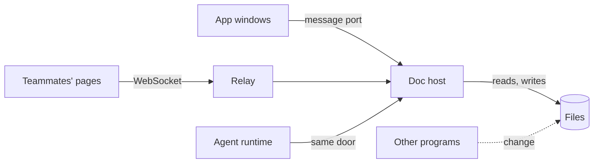

# Architecture

How the Ponjo app is built. How buddies run is a separate design that sits
on top of it: [agent runtime](agent-runtime.md). Every rule, limit and call
is in the [host spec](host-spec.md).

## Principles

| Principle | How the architecture follows it |
| --- | --- |
| **Files are the truth.** Docs, comments and buddies are plain files; everything else is a cache or this machine's own. | The doc host reads the files when a doc opens and writes them after every change. History, logs and runtime state live in the config folder and can be lost without losing a doc. A file changed by another program is merged in, not overwritten. |
| **One door, one writer.** Every change to a doc goes through one place, in one order. | Each open doc has one Doc component that applies changes one at a time and numbers them (`rev`). Windows, teammates' pages and the agent runtime all use the same door; none writes a file itself. |
| **Never lose typing.** What a person types survives other writers, crashes and failed writes. | Typing is merged by character (OT); late whole texts by line (`merge3`), the doc's lines winning. Each edit lands at most once, by its id. Files are written atomically, before clients are told. A failed write keeps the change and retries. |
| **Shared files are data, never instructions.** | Nothing read from a doc, its comments or a buddy file can start a program here. `who` is set from the connection, never from a message; levels are checked once, at the door. |
| **One component, one thing, through the fewest calls.** | Each component in the table below owns one kind of state behind a few calls. Imports only go one way, which `npm run lint` enforces. |
| **Stable ids, not names.** | Members, buddies, comments and edits are joined by id; names, paths and colors are only shown. |

## Context



The doc host is the only process that writes docs. Everyone else is a
client of it: app windows, teammates' pages through the relay, and the
agent runtime. Other programs may change the files; the host notices and
merges their changes.

## Processes

| Process | Code | Does |
| --- | --- | --- |
| Shell | `desktop/` | Electron main: windows, menus, dialogs, the keychain; starts the doc host |
| Pages | `web/` | the editor; turn typing into operations and back |
| Doc host | `src/host/`, `desktop/doc-host.js` | holds open docs, does every write |
| Relay | `relay/` | a Cloudflare Worker that forwards messages between the host and teammates' pages; stores nothing |

## Components in the doc host

| Component | Owns | Interface |
| --- | --- | --- |
| Doc (`doc-service.js`) | one open doc: its text, comments and change log, in memory | the door (below) |
| Opener (`open-doc.js`) | joins a doc to its [agent runtime](agent-runtime.md): the runtime hears each change and lands through the door | `openDoc` |
| History | the doc's versions on disk | `record`, `list`, `read` |
| Store | reading, writing and watching files | `read`, `write`, `watch`, `move` |
| ProjectService | the project's file tree, as everyone sees it | `list`, `read`, `open` |
| Room | who is in the shared room, at what level | `open`, `close`, `lock`, `setLevel`, `kick` |

## The door

Every client talks to a doc the same way:

```
call(type, arg, who)       who = { id, name, kind, level }, set by the host
  state                    → { text, threads, rev, ... }; with { since }, the changes missed
  submit / comment / undo  → a change, landed in order, told to all as an `ops` event
subscribe(fn)              every change as it lands (a client in the doc host)
```

`who` comes from the connection, never from the message. Levels are
`read < write < owner`, checked once at the door.

## Consistency

- **One writer per doc.** The doc applies changes one at a time and gives
  each a `rev`. A restart starts a new `epoch`.
- **Two ways to merge.** A window's edit is a small operation on a recent
  `rev`; it is shifted over newer changes by character (OT). A whole text
  that arrives late (an agent's result, an outside change, an undo) is
  merged by line (`merge3`), and the doc's lines win where both changed.
- **At most once.** Every edit has an id; a resend is answered, not landed
  again.
- **Catch up.** A client that missed anything asks for the changes since its
  `rev`, or the whole text if the log no longer reaches back.

## Persistence and failure

- The file is written after each change, before clients are told.
- Every write is atomic: a temp file, then rename. A crash never leaves a
  half-written file.
- A failed write keeps the change in memory, retries with backoff, and
  tells clients "not saved".
- A file changed outside is saved to history, then merged like a late text.

## Security

- Shared files are data, never instructions: nothing in them can start a
  program on this machine.
- A teammate's id is the hash of a key made in their browser.
- The relay can read what passes through it; it is ours.

## Code layout

```
src/core/   pure logic, shared by host and page
src/store/  files
src/host/   the doc host's components
web/        pages and editors
desktop/    the Electron shell
```

Imports only go down this list (`web/` and `desktop/` use the ones they
need); `npm run lint` enforces it.
