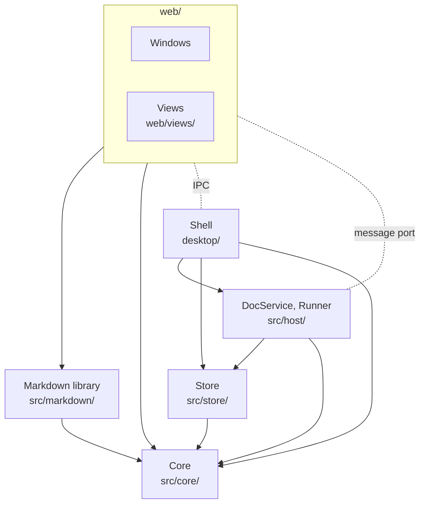

# Architecture

## Overview

How Ponjo is built, in three parts. [The app](#the-app): the doc host, a
background process that does every file write and runs the AI buddies, and
the windows you edit in. [A buddy's turn](#a-buddys-turn): AI buddies are
agents that answer comments, and a turn is one AI buddy answering one
comment: the app starts an agent program on a copy of the doc, then merges
what it changed back in. (The code calls a turn a run: `Runner`,
`runs.jsonl`.) [Sharing](#sharing): how a friend's browser joins the same
host, in a room the owner opens.

Sharing is built: the owner opens a room, friends join from its link at
once, read or edit, and see who is here and where each person's cursor
is; the room ends when the owner closes it or the project. Everything here
is what the code does.

No backward compatibility with earlier formats: a sidecar this version must
not write (another version, or no header) shows its comments read-only,
with a way to fix it.

### Principles

1. **Files are the truth.** Docs, sidecars and buddy files are plain files.
   Everything else is a cache, rebuilt from them, or only costs undo if
   lost.
2. **Only the app writes them.** An agent gets only a copy. Any other
   change (other editors, `git pull`) is seen and merged.
3. **An agent is a filter:** prompt on stdin, copies of the doc and its
   comments to edit, reply on stdout. It knows nothing of Ponjo and
   remembers nothing.
4. **No one resolves a conflict by hand.** Between people, nothing typed is
   dropped: the host orders their edits and merges them by character. An
   AI buddy's turn, a change from outside and an undo are merged with the
   doc by line on the host (`merge3`): where they changed the same lines as
   people, people's lines stay. A turn that collides is run once more
   first. What does not land is redone (ask the buddy again) or restored
   (history).
5. **AI buddies always edit, and every edit can be undone.** See
   [Undoing changes](#undoing-changes).
6. **Only a person's comment starts a turn:** mine, or a player's who can
   edit. Nothing in a shared file makes an AI buddy run, or chooses what
   program runs, on this machine.
7. **One component does one thing.** If it takes two sentences to say what
   a component does, it is two components.
8. **The fewest interfaces.** A new call is the last resort: first reuse one
   that exists, or delete the need. Who a writer is (a person, a buddy) is
   known only at the door every call comes through, never by the component
   that merges.
9. **Never take mutable state as the truth.** Find and join things by a
   stable id; a name, a path or a color is an alias that may change, kept
   only for show. A buddy is its id, not its name.

## The app

### Doc mode and project mode

The app has two modes:

- **Doc mode:** a `.md` file opened on its own (from Finder, say). It
  reaches the user's buddies. That holds even if the file sits in a
  project folder.
- **Project mode:** a folder opened from the home page. A file tree and
  its docs, the user's buddies and the project's own. The project's live
  in `.ponjo/buddies/` at the folder's root and travel with it
  ([PROJECT](../spec/PROJECT.md)).

| | Doc mode | Project mode |
| --- | --- | --- |
| Opened from | Finder: a `.md` file | The home page: a folder |
| Window | One doc | File tree and docs |
| Folder | none | the opened folder |

The asymmetry is intentional: doc mode is a light editor for one person
and their buddies, with no room and no sharing; project mode is the full
experience, many docs, the project's buddies and its room.

The user's buddies live in `buddies/` in their config folder and reach
every doc; a project's reach its docs only. In a project, a project's
buddy wins over one of the user's with its name. Otherwise they are
alike: name, face and color follow one rule ([PROJECT §2](../spec/PROJECT.md)).
The first run writes the user's first buddy, Clippy; then it is theirs.

### Components

A solid arrow is an import: `npm run lint` allows no others
(`.dependency-cruiser.js`), and no imports that go in a circle. A dotted
line is a message between processes.

| Component | Owns |
| --- | --- |
| Format | `X` + `X.comments.jsonl`, anchors on X's text ([SPEC](../spec/SPEC.md)) |
| Core (`src/core/`) | computing on text, the same in the doc host and the page; no I/O: anchors, diff (Myers', `diff.js`) and the three-way merge by line (`merge3`), text operations and how they merge by character (`ot.js`), the sidecar's lines and threads, @mentions and the inbox, what a buddy file and the settings may hold |
| Markdown library (`src/markdown/`) | not a view; what the Markdown view and the page use: a doc's rendered text and its map back to the source (`project.js`), and saving with the bytes of unchanged blocks kept (`splice.js`) |
| Store (`src/store/`) | the files: a doc and its sidecar, each written whole (`files.js`), watched (`watch.js`), and the doc's versions (`history.js`); the settings and agents (programs and their manifests) in the config folder; buddy files (the user's there, a project's in its folder) |
| DocService (`src/host/doc-service.js`) | every write to a doc and its sidecar, one at a time; outside changes; versions |
| Runner (`src/host/runner.js`) | which turns should start (the inbox), runs them, their status in memory |
| ProjectService (`src/host/project-service.js`) | the project's files, the same for everyone: what a folder holds, a file to show or open; every path resolved to its real path, inside the root, no part starting with `.` |
| Windows (`web/`) | the doc page: editing and commenting, through DocService. The page talks to its editor, a view, in offsets on the doc's text, turns its typing into operations and takes others' back (`client.js`), and works out the marks a view draws (comments, a draft, a revision). The page knows no format. Also the home page (`start.js`) |
| Views (`web/views/`) | built in; a doc's editor: what a person sees and types in. See Views. The Markdown view's parts are also in `web/`: `diagrams.js`, `markdown-schema.js`, `pm-text.js`, `review.js`; every view's find bar is `find.js` |
| Shell (`desktop/`) | the app: windows, menus, dialogs, recent docs and folders, the owner's changes to a project's files (new, rename, move, delete); starts the doc host (`doc-host.js`) and gives each page its port to it (`preload.cjs`); decrypts the agents' secrets, the one process with the keychain, and hands them to the doc host. An open doc's files only through its DocService; the settings, the agent scripts and files that are not open, through Store |
| Relay (`relay/`) | a Cloudflare Worker at `share.ponjo.app` that serves the player's page and joins the owner's doc host to players' pages, one Durable Object per room; stores nothing. See Sharing |
| Room (`src/host/room.js`) | a project's room while the owner hosts it, in memory: whether it is locked, its players and their levels, the ids kicked out. See Sharing |

DocService, Runner, ProjectService and Room run in the doc host, the app's utility process.
Windows reach it over Electron message ports; a player's page over the
relay.

### Views

A doc has one **view**, its editor, switched on or off alone
(`settings.json`: `views`, by id). A view has state (caret, undo, marks),
so it is built in and not an extension point.

| | View (`web/views/`) |
| --- | --- |
| Declared | `{ id, name, about, extensions, always?, limits?, createView, settings }` |
| Picked by | `viewFor(name, settings)` in `web/views/index.js`: the first enabled view that claims the extension, else Plain text (`always`, any UTF-8 text file up to 20 MB); a view only for a doc within its `limits`, see [Editing](#editing) |
| Its settings | an ordered list of fields `{ key, type: 'switch' \| 'choice' \| 'number', label, hint?, default, group?, when? }`, rendered as its page in Settings > Views; `viewSettings` keeps a stored value only if its field allows it |
| Must satisfy | the view contract, `test/views.test.js` |

The Plain text view (`web/views/plain/`) is CodeMirror showing the text as it
is, with CodeMirror's standard keys for code (Mod+/ comments out lines in a
language that has comments); line numbers, wrapping, font size, whitespace
marks, indent guides and indentation are its settings, with a status bar
(`status.js`) whose menu and toggles save the same settings. The Markdown view (`web/views/markdown/`, [design](markdown-view.md)) is
WYSIWYG; its toolbar (and the standard keys), outline, focus mode and
word count are parts of it, switched by its settings, not separate extensions.
It maps the doc's text to its own document through the rendered text, and
saves each block the user did not change as it was written.

How edits merge does not depend on the view or the format: people's by
character, the rest by line (see Interfaces).

**To add a view**: a folder in `web/views/` with its declaration, listed in
`VIEWS`, passing the contract test. Its features are its own settings.

Settings keep `views: { <id>: { enabled, ...values } }`;
the core checks only that shape (values boolean, string or number) and keeps
ids it does not know. Switching a view makes the affected views again from
the same text in every window, the history's too, after saving pending
typing; its own settings reach its view as they are.

### Editing

What a person can count on when they edit, alone or with others. To a
person, another writer changing their doc is one of three: a teammate, an
AI buddy, or an outside program (`git pull`, another editor). Editing alone
always has the last two, so alone is the case of one person. Every rule
below holds for any number of people and any kind of other writer, there is
one path for everyone (page → `web/client.js` → DocService), and one set of
tests covers it all, by parameters ([testing](testing-ci.md#editing-tests)).

**Scope.** Docs within the views' limits (below); up to 8 people editing at
once; a one-way network delay up to 150 ms. Past it editing may be slower,
but the A rules always hold and the person is told.

**A. Data**, with no tolerance:

| Id | Rule |
| --- | --- |
| A1 | Converge: once writers stop, every page's text is the host's text is the file. |
| A2 | Nothing lost: what a person typed and nobody deleted ends up in the file, through crashes, power loss and dropped lines. |
| A3 | Nothing twice: an edit lands at most once, through resends, restarts and write failures. |
| A4 | People first: people's edits merge by character, and nothing typed is lost. A buddy's turn, an outside change and an undo merge by line with the doc as it is when they land: where they changed the same lines as people, people's lines stay, and theirs can be found in history. A person's edit on its way when one lands moves over it by character, as over anyone's. |
| A5 | Text intact: no split surrogate pair, no U+FFFD; each line's end (LF, CRLF, CR), the BOM and the file's permissions kept; unchanged blocks saved byte for byte. |
| A6 | Shown is saved: whatever the page shows as saved is in the file; anything not saved is marked, with the reason. |

**B. Latency**, median and p95, the network aside, within the limits. The
numbers are `LATENCY` in `web/views/index.js`, which the tests read:

| Id | From | To | Within |
| --- | --- | --- | --- |
| B1 | the doc opened | an editable view | 3 s |
| B2 | a key | its character on screen | 30 ms, 100 ms |
| B3 | a key | its character in the file | 50 ms, 100 ms |
| B4 | another writer's edit arriving | it shown | 50 ms, 100 ms |
| B5 | a key | its character shown at a teammate | 50 ms, 100 ms |
| B6 | a person's cursor moving | it shown at the others | 100 ms p95 |
| B7 | the doc opened | the end of any one task that keeps the page busy | 500 ms |

**C. Recovery:**

| Id | Rule |
| --- | --- |
| C1 | Crash: killed and opened again, everything shown as saved is there; no file is half written. |
| C2 | Close: typing not landed lands before a window closes. |
| C3 | An outside change while typing: my text stays; the outside version goes to history. |
| C4 | A write that fails (a read-only file, a lock, a full disk): the page says Not saved, and why. Once the file can be written, the typing is saved, exactly once. |
| C5 | Reconnect: within 5 s of the line or the host coming back (30 s for a host waking from sleep), the page has caught up on text, comments, cursors and level. A window of the app whose doc host started again saves the typing done meanwhile, once; a player's page saves nothing typed before its line dropped (C6). |
| C6 | Line down: a player's page whose line drops, a half-open socket included, is read only at once and says so within 15 s; typing not sent then is shown as it was left, to copy (as in C7), never sent later. It edits again once caught up on the line made again, unless it shows such typing: then once reloaded. |
| C7 | Level: a level change applies within 2 s online, and on reconnect offline. Typing that can no longer be saved is never dropped silently: the page says so and shows that text, to copy. |
| C8 | Isolation: one page's bad request or oversized message never disconnects the others. A doc too big for the relay (`MAX_MESSAGE` in `relay/worker.js`, room for the Plain view's longest) does not open through sharing, and its page says so; an event that big is left out. |

**D. Editing**, whoever the other writer is:

| Id | Rule |
| --- | --- |
| D1 | My caret stays: others' edits never move my caret or selection off the character it is next to. |
| D2 | My viewport stays: when others edit above me, the line I am looking at keeps its place on screen. |
| D3 | My undo: Cmd+Z undoes only my typing, and still works after others split or restyle my paragraph. |
| D4 | IME: nothing is saved or sent mid-composition, and others' edits arriving meanwhile show once it ends (one in the text being composed would break it); they lose or double nothing. |
| D5 | The view never rewrites: after `applyText(t)`, `getText() === t`; a view's own normalisation is never saved as anyone's edit. |
| D6 | Clear marks: a teammate's typing shows only by their cursor; a buddy's change is flagged with its name; outside changes and restores glow. |
| D7 | Drafts stay: a comment being written, and its anchor, survive others' edits. |
| D8 | Comments follow their text: a thread stays on its text through others' edits, and through its buddy rewriting that text. |

**E. State:**

| Id | Rule |
| --- | --- |
| E1 | At any moment the page is in exactly one true state: Saved, Saving, Not saved (and why), Offline or Read-only. Alone too. No test yet: the page shows these apart, but not as one state. |

A view keeps the B rules only up to a size, its `limits`: how long the doc is, and
for the Markdown view how long a run of text without a blank line is (one
paragraph is parsed whole on every edit in it):

| View | Up to | Past it |
| --- | --- | --- |
| Markdown | 100,000 characters; no block over 10,000 | opens as plain text, and says so; the person may choose the Markdown view anyway, for that window |
| Plain text | 5,000,000 characters | opens read-only, and says so |
| Plain text's colour | no block over 10,000 characters | the doc opens without colour |

The desktop app opens text files up to 20 MB, room for the plain view's
limit in any script. `npm run test:perf` holds each view to the B rules at
its limits, and a key to a teammate's page through the relay
([testing](testing-ci.md#editing-tests)). A view sends each change the
person makes as it is made (`onEdit`), one edit on its way at a time: keys
typed while one is on its way go out together once it is answered, so
typing reaches others while it goes on, not once it pauses; a teammate far
from the relay sends one edit per round trip. Two dependencies are quadratic in one
paragraph's length; installs and builds patch them in node_modules, for the
page and the doc host alike (`scripts/patch-deps.js`), until
they are fixed upstream.

### Interfaces

The target: each component does one thing (principle 7) through the few
calls below (principle 8). Done: one `comment` call and one function that
builds a comment (#177), the Runner's `reconcile` (#178; the code calls
`stop`/`resume` for `pause`), `DocService.move` (`moveTo`, which the Shell
calls to rename an open doc), and every edit as operations on a revision,
with the views' side of them (#215; a restore is still its own call,
`restoreVersion`), and `undo` of any version (#286). Not
yet: Config, History and Store as the components below (today they are the
modules of `src/store/`), and the rest of what [Sharing](#sharing) needs:
teammates who edit, and `cursor`. The door is built for the owner, AI
buddies and a player's page (#223, #226); ProjectService (#229) and Room
(#286) are behind it, and an agent reads only the project's mirror, what
ProjectService shows (#230).

**Every writer comes through one door.** A page's call comes as
`call(type, arg, who)`, `who` being `{ id, name, kind, level }`. Each call
needs a level, `read < write < owner`, and the door lets it through only
when `who`'s level is at least that: `can(who, level)`, asked once; nothing
behind it checks again. A buddy's finished turn lands as the buddy, with
the level of whoever asked it. That is all
a permission is. What a writer does with it is behavior, decided elsewhere:
when an AI buddy resolves is its prompt's business, and how an edit
merges is its path's (a window's by character; a buddy's turn, an outside
change and an undo by line, before they land). Behind the door DocService uses `who` only to
put in a comment's `by`. A connection is bound to one doc at a time, as a
window's port is, so no call names a doc.

| Calls | Level |
| --- | --- |
| `state`, `history`, `version`, `cursor`, `image`; ProjectService's `list`, `read`, `open` | read |
| `submit`, `undo`, `comment` (resolving and reopening too) | write |
| everything else: `move`, settings, AI buddies, agent scripts, Room's own calls | owner |

The owner's level is owner. An AI buddy's turn acts with the level of
whoever asked it, at most write, as a Unix program runs as the user who
started it; a player's is read or write.

**Every edit is operations on a revision.** A submission is insert and delete
operations (offsets in UTF-16 code units of the doc's text) on
`{ epoch, rev }`, the revision it started from. DocService transforms it
against what landed since, by character: `transform` (`src/core/ot.js`),
which loses nothing typed. A buddy's turn, an outside change and an undo
never go through it: the host merges each by line with the doc as it is
(`merge3` in `src/core/diff.js`, from the text it started from), where
people's lines win, and lands the result as one edit at the current
revision, like anyone's. So one kind of edit goes through the order, and
a window's edit on its way when one lands moves over it by character, as
over any. An edit lands on the text in memory, the file is written, and
only then does it go to every window as `ops` (`{ epoch, rev, ops, id }`,
`id` the window's name for its own edit; a buddy's `reply` and `by`): a
window rebases what it has typed and not yet heard back (`web/client.js`).

**A window catches up one way**, whatever it missed: on every new
connection (`hello`), an event missed, an edit refused as `stale`, or an
answer whose event never came (its own edit's event comes before the
answer). It asks `state({ since: { epoch, rev } })`, and changes nothing
before the answer. While the log reaches back that far, the answer holds
the `events` missed, as they were told, and the window takes them as it
takes any, so it knows its own edit by its id. Only for a new epoch (the
doc host started again) or a log that no longer reaches back does it take
`diffOps(the text it last heard, the new text)` as what landed and move
its typing over that, as it was typed; its edit on its way is in that text
if the answer lists it as `landed`, the ids the doc's history folder
notes as written to the file, kept through every restart and every change
made outside since. An edit is landed
at most once: one whose fate a window does not know (the line dropped
before the answer) is sent again as it was, same id, same rev, and the
host answers one it already landed with its rev, never landing it again,
however long ago; a window never moves such an edit. A write that fails (a
read-only file, a lock, a full disk, a file made other than UTF-8 outside)
is not a refusal: the edit has landed, `submit` answers `not_saved`, and
the host writes it once it can, trying again half a second after, then
twice as long each time up to 10 seconds, and tells it then. A buddy's turn,
an undo and a restore that land meanwhile are landed all the same: the
turn is answered, and runs no more until its thread has another comment,
even if its reply could not be written. Every window hears whether the file
holds what they were told (`saved`, with why not), and `state` says it
too (`notSaved`), so a page shows Not saved, and why, exactly while it is so. When the doc
host started again, a window gets a new port and catches up, as a
teammate's page does on a new line. The log holds the last 1,000 edits, for windows' edits only: a buddy's turn, an
outside change and an undo each have their base text (the turn's copy, the
text the file last held, the version saved after the turn) and take
`diffOps(that base, the text now)` as what landed since, so they need no
log, after a restart or days later. History records a version each time
typing pauses (once everyone typing has paused: its `authors` are each
person who typed, #228), before and after each buddy's edit, an outside
change, an undo or a restore, and when the history is opened, each
credited to whoever made it. A version is never changed once written: each
names its `parent`, the version before it, and only the oldest go once the
history is full. The history view groups a burst of typing into one row.

**Undo of a version is one edit**: the inverse of its change, from its
parent's text to its own, merged by line with everything written since
(`merge3`), so lines someone changed since stay. A row of several versions
is undone as one, from the first's parent to the last. It works while the
version and its parent are kept, however many came after. Cmd+Z is the
editor's history, which holds only your own typing, mapped over what
others put in; its result is your typing, merged by character.

| Component | Its one thing | Interface |
| --- | --- | --- |
| Core | compute on text, purely; the page and the host share it | `diffOps(base, text)`, `transform(ops, landed, { first })` → ops, `apply(text, ops)`, `mapOffset(at, ops)`, `merge3(base, ours, theirs)` → `{ text, conflicts }`; `createAnchor`, `locate`; `parseSidecar`, `serializeSidecar`, `newComment`, `threadsOf`, `askedOf(thread, askers)` |
| Store | read, write, watch and move files | `read(path)`, `write(path, text, { ifHash })`, `watch(path, fn)`, `move(from, to)`. Settings, buddies, agent scripts and history are paths and parsers over these, not interfaces of their own |
| DocService | order every edit to a doc, and write it | `state({ since? })` → text, `{ epoch, rev }`, the `events` missed since, and what this connection may do; `submit({ ops, epoch, rev, id })` → `{ rev }`, or `stale`, or `not_saved`; `comment({ thread?, anchor?, body, resolved? })`; `undo({ id, from? })`, a version (or the versions from `from` to it) undone as above, a turn's from its reply; `cursor({ at, epoch, rev })`; `move(to)`; events `ops` (every landed edit, written), `saved` (`{ error }`: why the file does not hold them, or null), `sidecar`, `room`, `cursors`, `missing`; a window that connects again catches up with `state`. Cursors are never queued behind writes: each is kept at the last rev windows were told of, and moved with every edit told |
| History | keep the doc as it was at each version | `record`, `list`, `read`; a version may have several authors |
| Runner | make the running turns equal the asks the sidecar holds | `reconcile()`, `statuses()`, `pause(on)`. The asks are people's comments: the owner's and those of players who can edit. A finished turn comes through the door as its buddy, then is logged with its trace |
| Room | who plays in the project's room and what each may do, while it is open | for the owner `open()`, `close()`, `lock(locked)`, `setLevel(id, level)` with `level` `read` or `write`, `kick(id)` and `list()` (`{ link, locked, players }`, or null while closed), at the door as `openRoom`, `closeRoom`, `lockRoom`, `setLevel`, `kick` and `room`; a page that opens the link joins as `join({ id, name })`; the host asks it a player's level on each call; event `room` to the owner's windows |
| ProjectService | the project's files, the same for everyone | `list(path)`, `read(path)`, `open(path)`, for the owner's windows and a teammate's page alike. A path must resolve inside the root and not start with `.`. An agent reads no more than this |
| Config | own the settings, buddies and agents | `settings.get/patch`, `buddies.save/remove`, `scripts.list/reset` |
| View | the doc's editor: what a person sees and types in | its contract as today (`getText`, `applyText(text, { by, ops })` with the operations that made `text`, after which `getText()` is `text` and the line on top of the page is where it was, `setMarks`, the selection, and `composing()`, while an IME composition is on: its text goes out only once it ends, as one edit); the page turns its text into operations and back (`web/client.js`, [plan A](markdown-view.md#many-writers)) |
| Shell | windows, menus, dialogs, recent docs | an open doc's files only through `DocService` (renaming through `DocService.move`), the sidebar through ProjectService (a folder window with no doc: the folder's own, `list`, `read` and `open` only); the settings and agent scripts through Store and Config |
| Agent | edit its copy, append to its sidecar, print a reply | none: it cannot call anything |

The page's calls: `state`, `submit`, `comment`, `undo`, `cursor`, `history`,
`version`, ProjectService's three, and for the owner settings, buddies,
agent scripts and Room. `reply`, `resolve`, `reopen`, `saveDoc` and
`restoreVersion` go: a reply, a resolve and a reopen are each `comment`; a
restore is a `submit` of the operations back to an old version's text, so it
needs edit, as typing it would.

A **journal** of what happened (history, comments, `runs.jsonl`) is not a
component: if it is wanted, a view joins the three by `reply` and `thread`
when read. Nothing stores it.

### How files are read and written

- DocService reads the doc and its sidecar when the doc opens, keeping a
  hash of each. Windows never read the files; they ask DocService, which
  holds the doc's text as its edits land (see Interfaces) and writes it as
  each lands, before telling the windows.
- It watches both files, through a folder watch and a poll every 500 ms
  for file systems where watches miss changes. When the sidecar's hash
  changes, it tells every window; a doc it did not write is a change from
  outside: saved to history first, then merged by line (`merge3`) from the
  text the file held when last written, and landed. Where it changed the
  same lines as what was typed since, the typing wins and the outside
  version is only in history. It is
  taken once the file is unchanged for 50 ms (up to a second): another
  program may be half way through writing it, emptied with the rest to
  come.
- Before writing, DocService checks the file is still what it last wrote;
  if not, it lands the outside change first, the same way. A file whose
  size, mtime and inode are still those of its own last write is not read
  again, nor when the watch fires for that write: a doc of millions of
  characters takes tens of milliseconds to read and hash, on every key
  (#235).
- Every file is written whole: a temporary file in the same folder, with
  the file's permissions, renamed over it.
- Above the files, a doc is its text: UTF-8, no byte order mark, lines
  ending in `\n`. The file's byte order mark and each line's end are put
  back when it is written, a new line ending as the line before it; a file
  that is not UTF-8 does not open.

### Undoing changes

An undo takes some edits back, all at once, and keeps everything written
since: where someone changed that text since, their text stays.

1. **Your own typing:** Cmd+Z, which undoes only yours, as in shared docs.
2. **An AI buddy's turn:** Undo on its reply: the change of its version.
3. **Any change:** Undo this change in history, for a version or a row of
   them, whoever made it; or restore a whole version.

Each saves a version first. An undo is the same `merge3` a buddy's turn
goes through (see Interfaces): the version's change taken back, where no
one changed its lines since. It works where the versions are, on the doc
host, from any window of the team, as whoever clicked it. Cmd+Z is the
editor's own history, your typing only, and its result is typing like any
other: a person's edit, merged by character.

### The config folder

In the config folder (`~/Library/Application Support/Ponjo/` on macOS),
written only by the app.

| File | Holds |
| --- | --- |
| `settings.json` | the user's id and name; editor preferences; views' and agents' settings; which agent runs buddies |
| `agents/` | agents: each a program and its manifest ([agent config](agent-config.md#agents)); Claude Code, Codex and the Ponjo agent ship |
| `secrets.bin` | the agents' secret settings, such as API keys, encrypted with the system keychain |
| `state.json` | recent docs and folders, window bounds |
| `history/` | versions of each doc, saved each time typing pauses, before and after each buddy edit (tagged with its reply's id), before each outside change, undo and restore; and the windows' edits the doc's file was last written with; the comments this host took |
| `mirrors/` | each project's mirror: a copy of what the project shows, cloned for each run (`src/host/mirror.js`) |
| `logs/` | `runs.jsonl`, a line per turn; with Trace runs on, `traces/`, each turn's trace ([a buddy's turn](#a-buddys-turn)) |

## A buddy's turn

A thread waits on AI buddy X (by id) when a person's comment that may ask, newer
than X's last comment there, asks X: the owner's, or a player's who can
edit. A comment asks whom it @mentions; one that
mentions no one asks the thread's AI buddies: the one that opened it, and
each @mentioned there before. An empty one (resolving, reopening) asks no
one. That is computed from the sidecar, the comments this host took, and
the ids of those who may ask. AI buddies run only on docs open in a window.

### How a turn works

1. Runner copies the doc and its sidecar into a new private folder and runs
   the [agent script](agent-config.md) there, with the prompt (who the
   buddy is, the thread, the rules) on stdin and the buddy's name in
   `PONJO_BUDDY` (the name is for the script; the app goes by id). In
   project mode the project is a copy of its own, cloned from the
   project's mirror once that is brought up to date: the mirror is a copy
   in the config folder of what ProjectService shows, but `node_modules`
   and files that are not text or are over 20 MB, so an agent never learns
   the real path or reads what a teammate may not. Nothing the run reads
   changes while it works: another run's writes and later syncs reach
   only their own copies. Its copy goes when it ends.
2. The agent edits the doc copy, appends comments to the sidecar copy, and
   prints its reply on stdout.
3. On exit 0, DocService merges the doc copy with the doc as it is, from
   the copy as it started (`merge3`, see Interfaces). Where people changed
   none of the same lines meanwhile, it saves versions before and after,
   lands the merge, adds the appended comments as the buddy's, and writes
   the reply as the buddy's comment. Where they did, nothing lands and
   nothing is posted: the ask runs once more, on the doc as it is then,
   and its prompt says what the turn changed and what people did. Run
   once more and colliding again, it lands with people's lines kept there,
   and its version says `conflict`. The turn lands as the buddy's.
   The reply and comments are dated just after the last comment the turn
   was given, so a comment the user wrote meanwhile still waits on X.
4. The private folder is deleted, and the turn gets a line in the config
   folder's `logs/runs.jsonl`: its run id, doc, buddy, thread, reply, start,
   duration, and `ok`, `failed`, `timedOut` or `stopped` with the exit code.
   A `.jsonl` log there past 10 MB, an agent's too, then keeps its newest
   half. With Settings > Agents > Trace runs on (off by default), the turn
   also leaves its trace in `logs/traces/<run>.json`, the newest 200 kept:
   the prompt, the steps the agent wrote to `PONJO_TRACE`
   ([agent config](agent-config.md#traces)), stdout and stderr, the doc
   and sidecar copies before and after, and what landed. The owner's
   window reads them in the doc's Runs (`runs()`, `trace({ run })`), and a
   buddy's reply links to its run's.

Resolving a thread ends its turns at once, with no answer; a turn that
ended but is not merged yet is dropped. Deleting a buddy ends its turns too.

An AI buddy comments as a person does: new threads, replies in any thread.
It resolves the thread it answers when the comment asks it to: its reply
carries `resolved`. Anything else is ignored
([agent config](agent-config.md#comments)). Its comments start no turns
(principle 6).

### What the user sees after a turn

What the app knows, the app shows, not the buddy's reply: under the reply,
how many places the turn edited, with Undo; a turn whose version says
`conflict` says that part of it was not applied; its comments are in the
margin. The reply says only what the
app cannot (why, what to decide), and may be empty. The turn's edits land at
once, shown as a revision (new text in the buddy's color, removed text
struck through) until the user next types or another turn's edits land;
clicking the count shows the turn's alone again. The count, the revision and Undo are
read from the version saved after the turn and the one before it, in every
window of the team, since the versions are on the host.

### Failures, retries and restarts

A turn that fails is answered too: the buddy's comment is marked `failed`,
with the end of the program's output. One ask, one reply (a turn run once
more answers once); to retry, or to redo what was not applied, @mention
the buddy again. Which turns are working lives
only in memory: after a restart, unanswered asks run again. Turns go on at
the same time; their merges are applied one at a time.

## Sharing

Sharing is hosting a room, as for an online game. In a project window the
owner opens a room; friends join from its link in a browser, at once;
the room ends when the owner closes it or the project. Built: a page
reads a doc through the relay (#226); players who edit (#228); the relay
deployed (#241); the project's tree and every doc in it (#242); rooms
(#286). The files stay on the owner's machine. Players are trusted: in a
doc a player who can edit does what the owner does. Doc mode has no
sharing.

- **One host.** The owner's doc host holds the files, does every write and
  runs the AI buddies, as always. A player's page is a client of it: it
  keeps only what it shows, and a reload resyncs it from the host. A page
  whose line drops is read only at once and says so (C6): it notices a
  dropped or half-open line within 10 s, a ping unanswered (the relay
  answers `ping` itself); typing it had not sent is shown to copy, never
  sent later. It reconnects by itself and, caught up, edits again. The
  app's own windows reach the host over message ports, not the relay: one
  whose doc host started again saves its typing once caught up (C5).
- **A room** (`src/host/room.js`) is `{ locked, players: id → { name,
  level }, kicked }` in the doc host's memory, and dies with it: nothing
  about players is written. Open room (the owner's `openRoom`) makes a
  fresh random secret and puts the host on the relay in the room named by
  its SHA-256, answering once the host is in. Close room, or closing the
  project's last window of the app, ends it at once: every page is turned
  away, `closed`, and docs only pages had open close. The next room has a
  new secret, so an old link never opens a later room; a page on it hears
  that no host is in (`nohost`).
- **A relay** (`relay/worker.js`, a Cloudflare Worker, one Durable Object
  per room) joins the host's outgoing WebSocket to each player's, over
  TLS, and stores nothing. It is at `share.ponjo.app`, on the owner of
  this repo's Cloudflare account, and serves the player's page too, so
  page and relay share one origin (the page may connect to its own origin
  only). There is no encryption of our own: the relay is
  ours, and it could read what passes. The host has one connection for all
  its pages: the relay numbers each page as a peer, which a page cannot
  forge. No credential is in an address: the host's first message is the
  secret, which the relay checks against the room before it takes the
  host in, so a link, which names only the room, lets no one pose as the
  host; a page's first message is its key, name and doc. The app's
  relay is `wss://share.ponjo.app` unless `PONJO_RELAY` names another
  (empty: nothing is shared).
- **Limits**, so the relay is no free pipe and stays within the Workers
  free plan: at most 20 pages in a room (one more is turned away, `full`),
  no message over 8 MiB characters (its sender is closed), and at most 60
  hosts and 120 pages a minute from one address, so a leaked link cannot be
  hammered. Sockets hibernate between messages, so an idle room costs
  nothing; a page waiting for its host, and a host for the relay, try
  again twice as long each time, up to 30 seconds.
- **One seam.** A page talks to the host through `{ call, onEvent }`: in the
  app a message port, in a browser the relay (`web/relay.js`). The host
  serves both the same way (`serve` in `desktop/doc-host.js`), adding a
  `who` to every call. `team.html` (built with the app's pages, in
  `dist/web`) is the doc window on the relay; in the preview (`preview/`)
  `doc-stub.js` plays the host instead.
  A page names its doc by its path in the project, or none for the
  project's first; `state` tells it that path and the project's name
  (`place`), for its sidebar (`web/files.js`), which reads the tree through
  the door (`list`, `read`) and opens another doc as the page of the same
  link on it, let in at once. The doc is open once however many windows
  and pages have it. Anyone but the owner gets the default settings, not the
  owner's, and a path in the project, not its real path. A page the host
  turns away is told why (`closed`, `kicked`, `locked`, `not_found`,
  `hidden`, `full`), and opens again with nothing but that (`?gone=`), so
  nothing of the room stays in its memory, unsent typing included.
- **Presence.** The host tells everyone on a project who has a window or
  page on any of its docs (`here`), each person once and whether on the
  same doc; a person not there is away, greyed. Each person's cursor goes
  to the host once their typing has landed (`cursor`, on the rev they
  have), and the host tells it to everyone on the doc (`cursors`); a page
  moves it over the edits it hears of and its own typing not landed yet
  (`web/client.js`), so it stays where its text is.
- **Everyone is a participant**: `{ id, name, kind, level }`. The host sets
  `who` from the connection and never trusts one sent in a message. A
  player's id is the hash of a key made once in their browser, which
  only that browser and the host (through the relay) see, so no one who
  reads an id in a comment can pose as them; an AI buddy's is in its file.
  An id is for credit on comments and edits only; what it may do lives in
  the room. Names are unique on a project, people's and AI buddies'
  together: a player whose name is taken gets a number (`Alice2`), and
  DocService refuses a buddy's or the owner's name a player has.
  `can(who, level)` is the one place that decides:
  - *Owner:* rename, move, delete and create files; settings, AI buddies
    and agent scripts; and all a player who can edit may.
  - *A player's access*, Read or Edit (write), Edit when they join and
    changed in the Team panel. Edit is everything the owner does in
    a doc: edit, comment, resolve, ask AI buddies. A page is told `level`
    when it changes and catches up; every catch-up brings the page's level,
    so a page away at the change, or one whose edit is refused as
    `forbidden`, learns it then. It opens again as the new level. Typing it
    can no longer save is kept, never dropped: shown as it was left, in a
    view that cannot be edited, to copy, with Not saved; and saved if the
    page is set back to Edit.
  - *An AI buddy* acts with the level of whoever asked it, at most write.
  - A comment's `kind` (`human`, `ai`) says only whether an agent is behind
    it; it decides nothing.
- **Joining.** The link names the room, and opens the page the relay
  serves at the same origin (`https://share.ponjo.app/team?room=<room>`).
  The page asks a name once, kept in the browser, and joins with it and
  its key: anyone with the link is in at once, at Edit. In the Team panel
  the owner sees the players, live, sets each to Read or Edit, and kicks
  one: their pages are turned away and that id cannot come back to this
  room (a fresh browser can, until the room is locked). Lock lets no new
  id in; players already in come back after a dropped line.
- **Scope is the project folder**, served by a `ProjectService` to the
  owner's windows and players alike, so both see the same tree. A path is
  resolved to its real path and must be inside the root; a link out of it,
  or a name starting with `.`, is refused. An AI buddy's agent reads no more
  than that, so nothing hidden reaches a doc through it.
- **One order.** The host orders every edit to a doc, people's and AI
  buddies' alike, and a person's typing is never dropped; see
  [Interfaces](#interfaces). How the Markdown view takes part is
  [its own design](markdown-view.md), to be proven by a prototype first.
