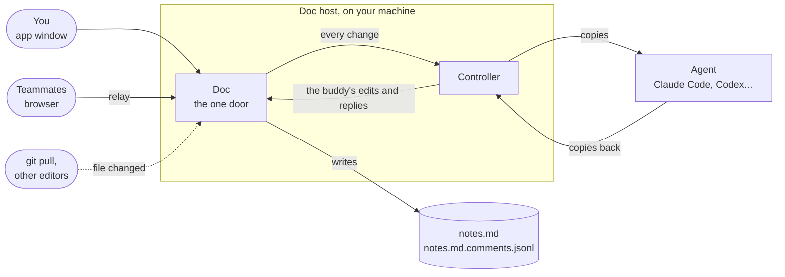
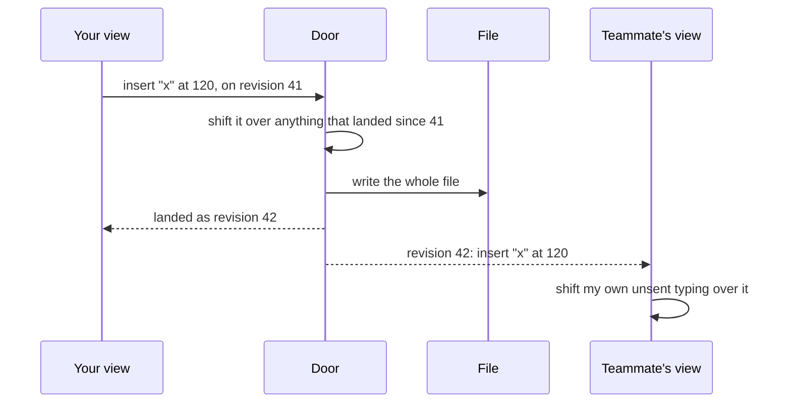
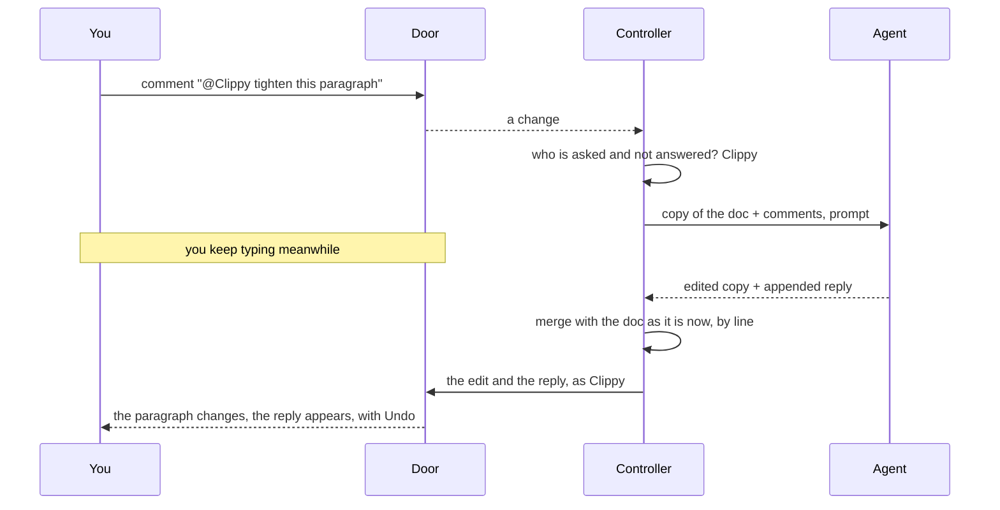
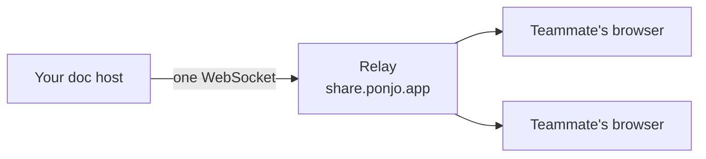
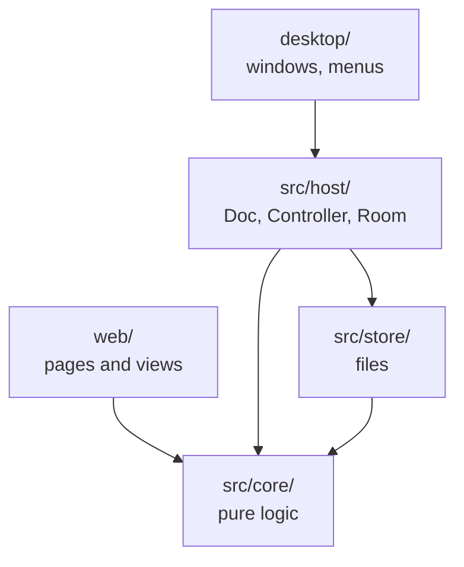

# Ponjo's architecture

This is the picture to hold in your head before you read the code: what
the parts are, how a change travels through them, and why it is built this
way. The rules and numbers are in the [host spec](host-spec.md); the
comment format in [SPEC](../spec/SPEC.md).

## The picture

People and AI buddies write the same plain text files together.

One background process on your machine, the **doc host**, holds every open
doc. Everything that changes a doc goes through that doc's one **door**:
your typing, a teammate's typing from their browser, a buddy's edit, a
`git pull`. The door puts the changes in one order, merges them, and writes
the file.

Beside each doc sits a **controller**. It watches the changes go by and
decides when a buddy should work. When one should, it hands an **agent**,
an ordinary command-line program, a copy of the doc and its comments. The
agent edits the copy and writes its reply; the controller brings the result
back through the same door, signed as the buddy.

That is the whole system. The rest of this page is why each piece is
shaped the way it is.

## Five ideas

**1. Files are the truth.** A doc is a plain file; its comments are a
second plain file next to it; a buddy is a third. You can open them in
another editor, commit them to git, sync them with Dropbox. Anything else
the app keeps (history, logs, which buddy is running) is either rebuilt
from the files or only matters on this machine, and is never written into
the shared files.

**2. One door, one order.** Many writers on one text is the hard part of
the app. Instead of each writer touching the file, they all send their
changes to the door, which applies them one at a time. There is exactly
one place where conflicts are handled, and it does not care who wrote what.

**3. Buddies are members, agents are filters.** To the doc, a buddy is just
another member, like a person: it edits and comments through the same door.
The work is done by an agent that knows nothing about Ponjo: it gets copies
in a temporary folder and a prompt, and leaves changed copies behind. Any
command-line agent works, and none of them can touch your real files.

**4. Decide from state, not from events.** The controller never thinks
"a comment just arrived, so run Clippy". It thinks "looking at the doc as
it is now, who has an unanswered question?" Events only tell it *when* to
look. So a missed event costs nothing, a restart loses nothing, and the
same look at any time gives the same answer. This is how Kubernetes
controllers work, and for the same reason.

**5. People stay in control.** Only a person can start a buddy, by asking
it in a comment or by turning on its watch. Every change a buddy makes can
be undone from the comment it came with. A run that fails is shown to you
with a Retry button, not retried in a loop, because agents are slow and
cost money.

## Following a keystroke

Your keystroke becomes a small operation ("insert at offset 120") tagged
with the revision your screen showed. If someone else's edit landed in
between, the door shifts yours over it, character by character (operational
transformation, `src/core/ot.js`). Nothing anyone types is lost, and your
caret never jumps. The file is written before anyone is told, so what the
screen says is saved really is.

## Following a question to a buddy

The agent may work for a minute while you keep typing, so its edit arrives
late, against an old text. The door cannot shift a whole rewritten paragraph
character by character into your fresh typing without making nonsense. So
late, whole texts are merged **by line** (`merge3`): where you and the
buddy touched different lines, both land; where you touched the same line,
yours stays, and the buddy's version is kept in history. The edit lands as
its own version, hung on its reply, so Undo on that reply takes back exactly
that edit and nothing else.

The question is answered once the buddy has replied after it. That is all
the "state" an ask has: it is read from the comments file, not stored
anywhere else.

## Watching, and buddies waking each other

Some buddies should follow along rather than wait to be asked: a
proofreader, a buddy you chat with as you write. A person turns on **watch**
in the buddy's card. The buddy then runs each time people pause typing for
5 seconds, and at once when another buddy changes the doc, so two watchers
can even play a game in a doc. A buddy's own change never wakes itself.

Two buddies waking each other could go on for ever, so each doc has a small
budget of **steps**, refilled one per minute: each run woken by another
buddy spends one. People's pauses spend none. When the steps run out, the
buddies wait, and the status bar offers Refill.

## When things go wrong

| What happens | What the app does |
| --- | --- |
| Another program changes the file | Saved to history, then merged by line like a buddy's edit; your typing wins where it collides |
| The file can't be written (read-only, disk full) | The edit stays, the page says Not saved and why, and it is written once it can be |
| The app crashes | Every file is written whole (temp file, then rename), so nothing is half written; what was shown as saved is there |
| A teammate's connection drops | Their page goes read-only at once, and catches up when it reconnects; unsent typing is shown to copy, never silently sent late |
| A buddy's run fails | Nothing is written; the thread shows the failure with Retry; the owner sees why |

## Sharing

Sharing works like hosting a game. You open a room; teammates open its link
in a browser and are in at once. Their pages talk to your doc host through
a small relay that only forwards messages and stores nothing. The files
never leave your machine, and a teammate's page uses the same door, with
the same calls, as your own window. Close the room and everyone is out.

## The code

Imports only go down this picture; `npm run lint` enforces it. `src/core/`
is pure logic shared by the host and the page: operations, merging, the
comment format, and the rules for who runs. `src/store/` reads and writes
files. `src/host/` holds the doc host's parts. `web/` is what you see,
including the editors (`web/views/`). The doc host and the pages only talk
by messages.

Not built yet: today `src/host/doc-service.js` holds both the door and the
buddies' side; splitting the controller out is the next step.

## Read next

- [Host spec](host-spec.md): every rule, limit and call
- [SPEC](../spec/SPEC.md): the comments file format
- [Agent config](agent-config.md): how to plug in an agent
- [Markdown view](markdown-view.md): the live-preview editor
- [Testing](testing-ci.md): how the rules are tested
