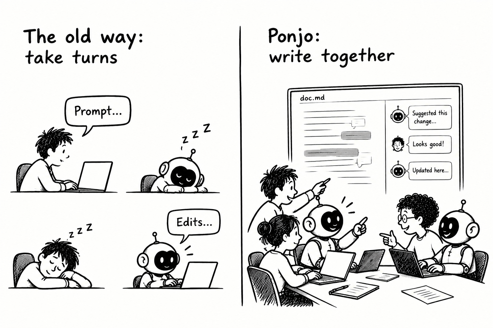

# Co-write with AI like you do with teammates

Today, writing with AI means **taking turns:** you prompt in a chat, wait, then switch to the doc to review what changed. Only one side works at a time, and your focus keeps jumping between the chat and the doc.

**Ponjo** is an open-source editor where you and your AI buddies write the same file **at the same time**. Comment on a passage and @mention a buddy. The AI buddy (agent) edits and replies right there while you keep writing.

- **You stay in control.** Buddies change only what you asked about, and every change can be undone in one click.
- **An agent built for co-writing.** Ponjo's own agent does just what writing together needs: read, comment and edit. It works in the doc as a teammate does, seeing the same text and threads you see.
- **Many buddies, one team.** Several personalized buddies work in the same doc at once, like teammates in a review.
- **Teammates join from a link.** Friends write with you from their browser, with no install or account.

AI buddies aren't a delegate you wait on. They write beside you, and you stay focused on the writing.