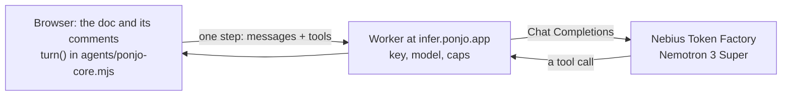

# Ponjo on NVIDIA Nemotron

Ponjo is a text editor where people and AI buddies co-author the same doc:
you select text, @mention a buddy in a comment, and it reads the doc, edits
what you asked about and replies in the thread. For the Nebius x NVIDIA
Global AI Hackathon (Best Apps and Agents track), every buddy's answer in the
web demo is a run of NVIDIA Nemotron 3 Super on Nebius Token Factory.

## Try it

Open <https://ponjo.app/preview/> in any browser, desktop or phone. No
install, no account: the doc and its comments stay in that tab.

1. Select the paragraph under "Why Ponjo" and comment "@Clippy make this
   half as long". The paragraph is rewritten in place and the edit is marked.
   Clippy's receipt shows the edit and undoes it in one click.
2. Ask "@Clippy is anything wrong here?" on the paragraph under "How it
   works": it has one wrong fact.
3. Ask a question, such as "@Clippy who is Ponjo for?": Clippy answers and
   leaves the doc as it is.

<https://ponjo.app/preview/?folder> opens a sample project instead, where the
buddies Editor and Researcher can read every file in it.

## How it uses Nemotron and Token Factory



- **Nemotron drives an agent loop, not a chat.** A turn
  ([docs/ponjo-agent.md](ponjo-agent.md)) gives the model two tools: `read`
  a file by line numbers, and `propose` edits quoted exactly from the doc,
  comments, and a reply. It reads what it needs, then proposes; the app
  checks every proposal (each quote found once, only the doc and its
  comments touched) and sends a bad one back saying what to fix. The model
  never writes a file itself.
- **Nemotron 3 Super** fits this: scoped edits need accurate tool calls and
  instruction following, answered while the person waits, not long
  reasoning. The prompt also asks it to tell a question (answer, edit
  nothing) from an instruction (edit only what was asked).
- **The turn runs in the page.** The same code as the desktop app's Ponjo
  agent, with the doc in memory. Only each model step leaves the browser.
- **The Worker holds the key** (`relay/worker.js`, the `hackathon` env in
  `relay/wrangler.toml`): it takes only the messages and tools from
  `https://ponjo.app`, adds the model, the key and a token cap, makes every
  step call a tool (Nemotron answers a question in plain text otherwise),
  lets an address ask 60 times a minute, and passes the answer back as is.
- **Token Factory speaks Chat Completions**, so the agent's existing
  OpenAI-compatible path ran Nemotron unchanged, and one key serves the web
  demo and the desktop app.

## Run it yourself

The desktop app runs the same turn on your own key:

```bash
npm install
npm run desktop
```

In Settings > Agents, choose the Ponjo agent, with the provider Nebius Token
Factory (its model, `nvidia/nemotron-3-super-120b-a12b`, is the default) and
your [Token Factory](https://tokenfactory.nebius.com) API key; then @mention
a buddy in any doc.

`npm test` runs the Worker in front of a fake model (`test/infer.test.js`);
`npx wrangler deploy --env hackathon` in `relay/` deploys your own, with
the secret `TOKEN_FACTORY_KEY`.

## Where the code is

| Part | Files |
| --- | --- |
| The turn, its tools and the Token Factory provider | `agents/ponjo-core.mjs` |
| The prompt a buddy gets | `src/core/prompt.js` |
| The web demo's buddies: run, land the edit, reply | `preview/doc-stub.js` |
| The model's Worker | `relay/worker.js`, `relay/wrangler.toml` |
