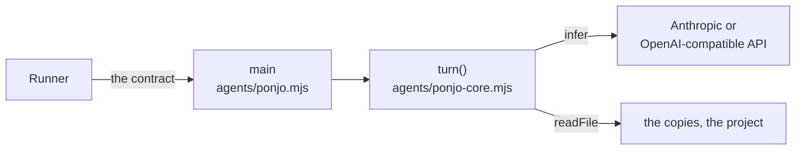

# Ponjo Agent

An agent of our own, run like Claude Code and Codex: a script in
`agents/` under the same [contract](agent-config.md#the-contract). Inside,
an LLM reads and proposes; the program checks and applies.

Claude Code and Codex are black boxes (their prompts, shell and web tools,
permissions, start-up time) for work that is narrow: read, comment, edit
text. Our own loop for only that is small enough to read whole, and runs a
cloud model of your choice. Local models are not a goal for now: the ones a
laptop runs (an 8B model tried) claim edits they did not make.

## Principles

1. **Read and propose, never write.** The model's only effect is a
   proposal; the program checks it and applies it to the copies.
2. **The tools are the permissions.** `read`, `find`, `grep` and `propose` only: no shell,
   no network but the model's API. Text a teammate wrote can at worst make an undoable proposal.
3. **Stateless.** A turn remembers nothing after. Within it, all state is
   the messages, and its trace replays it.
4. **The model asks for context.** The first message is small: the prompt
   and the project's file names, as a person sees them in the sidebar; the
   model reads what it needs.
5. **Read by line number, write by quote.** Never count characters.

## Interfaces

| Interface | Called by |
| --- | --- |
| `turn({ prompt, doc, sidecar }, { infer, readFile, resolve }) → { edits, reply }` | the program's `main`; the preview's buddies (`preview/doc-stub.js`) |
| `infer(messages, tools) → { calls: [{ id, name, args }], text, sent, usage }` | `turn`, for each step |
| `read`, `find`, `grep`, `propose` | the model, as tools |

**`main`** is all the I/O, and all of the contract: it reads the prompt on
stdin, the paths in `PONJO_DOC`, `PONJO_COMMENTS` and `PONJO_PROJECT`
and its settings in `PONJO_SETTING_*`, calls `turn`, applies the edits to
the copies, prints the reply and exits 0. A run without a key fails at once,
saying where to set it.

**`turn`** is one buddy answering one thread, with no I/O of its own: it
thinks, and checks what it proposes. `prompt` is stdin as is; `doc` and
`sidecar` are the copies' paths in the project, and `resolve` puts a path
the model wrote in that form. It throws when the turn fails. It
and each `infer` are in `ponjo-core.mjs`, which imports nothing, so a
browser runs them too; `main` and `readFile` are in `ponjo.mjs`.

**Paths are the project's only**, as a person in it would write them:
relative to its top, `/` between folders. An absolute path, or one out of
the project, is no file, so a turn's trace never shows where a run keeps
its copies or where the project is. `main` finds the copies' paths in the
project from where they sit in the working folder.

**`readFile(path)`** gives a file's text, a folder's entries (a subfolder's
ending in `/`), or null, and is all the turn can see: the copies, and the
project's files as the app shows them (inside the folder, not starting with
`.`, sidecars included), and of files only text (no NUL byte) of 20 MB or
less; in doc mode, the working folder, which holds only the copies. It reads
the project folder itself, so it is the boundary: what it refuses, no
teammate's comment can get a buddy to read. Tests run one table of cases on
it and on the app's ProjectService, so the two cannot drift.

**`infer`** is one step of the model, one implementation per provider,
over plain HTTP (the program runs from the config folder, with no
dependencies). `turn` keeps the messages in one neutral form (the prompt,
each step's calls with the model's message as its API sent it, and each
call's result), and each `infer` translates them:

| `provider` | API | Its own |
| --- | --- | --- |
| `anthropic` | Messages (`/v1/messages`) | `output_config.effort`, the model thinking as it needs; its messages sent back as they came, thinking included; prompt caching of the tools and the prompt; a refusal or a cut-off answer fails the turn |
| `openai` | Chat Completions at `endpoint` (OpenAI, OpenRouter and others) | `reasoning_effort` |
| `nebius` | Chat Completions at Nebius Token Factory, for NVIDIA's Nemotron models | no effort; `tool_choice: "required"` |

`anthropic` and `openai` send `tool_choice: "auto"`: current Claude models
refuse a forced tool call. A step without one is the model's answer, as for
any agent: its `text` is the reply, with no edits. `nebius` forces a call at
every step, so the turn ends only with `propose`: Nemotron otherwise answers
in plain text before it has read what the comment needs.

**`read({ path, lines? })`** returns the text with line numbers, from line
`lines[0]` to `lines[1]`. A file over 20,000 characters without `lines`
returns its outline instead (Markdown headings with their line ranges); a
folder, its files.

**`find({ pattern, path? })`** returns the paths of the files under the
folder `path` (the project's top if left out) that `pattern` matches, sorted.
`pattern` is a JavaScript regular expression, not a glob, matched against
each path in the project; as in the sidebar's filter, case is ignored unless
it has a capital letter. An invalid one says what is wrong and that it is not
a glob.

**`grep({ pattern, path? })`** searches the lines of the files under `path`,
a folder or a file, with the same pattern: each file's path, then each line
it matches as `read` gives it, cut at 500 characters. Both walk the folders
with `readFile`, and give at most 100 paths or lines, then how many more,
saying to narrow the pattern or the path.

**`propose({ edits: [{ path, old, new }], reply })`** ends the turn. On the
doc, `old` must be found exactly once. On its sidecar, `old` is empty and
`new` appends comment lines ([agent config](agent-config.md#comments)). Any
other path is refused. One bad edit sends the whole proposal back, saying
what to fix. `reply` is printed, and may be empty.

## The loop

```
step(messages, budget):
  call = infer(messages, tools)
  if there is no call: return no edits, and its text as the reply
  if call is a valid propose: return its args
  if budget is 0: fail
  return step(messages + call + result(call), budget - 1)
```

The first message is the prompt, as is: its rules are every agent's. Then,
in a project, its files as the sidebar shows them (no sidecar of a file
there), so the model knows which docs a comment can mean: every path up to
200, else the top folder's entries, saying to find the rest. The
tools match the contract it describes: `propose` edits the doc and appends
to the sidecar, and its `reply` is what the prompt says to print. Twenty
steps, and the turn fails.

## Architecture



- **Shipped, then the user's,** like the other scripts: theirs to read,
  change, or rewrite in any language that keeps the contract.
- **Its settings** are in its [manifest](agent-config.md#agents), not in
  the program:

| Key | Type | Default |
| --- | --- | --- |
| `provider` | choice: Anthropic, OpenAI-compatible, Nebius Token Factory | `anthropic` |
| `endpoint` | text, for OpenAI-compatible only | `https://api.openai.com/v1` |
| `model` | text | `claude-opus-5-5` |
| `key` | secret | none: a run without one fails, saying where to set it |
| `effort` | choice: low, medium, high | `low`: scoped edits; higher thinks longer before it answers |

- **Tests** call `turn` with a fake `infer`, and each `infer` on a fake
  server of its API. `npm run bench:agent` runs `turn` on a real model
  in a sample project, for comments that name a file in different ways,
  and scores whether it read the file each one means.
- **Each turn's messages go to its trace** (`PONJO_TRACE`, [agent
  config](agent-config.md#traces)), a line each as they come, but the
  prompt, which the app has: the model's with how long it took and its
  `usage`, each call's result after it. The app keeps them only while
  Trace runs is on.

## Open questions

- A step waits for the whole answer, at most 16,000 tokens, with no
  streaming: Node's `fetch` gives up on a reply that takes over five
  minutes to start, which a high effort could reach.
- No fallback model when Anthropic's safeguards refuse: the turn fails,
  saying so.
- Later: web access, off by default, the one tool that could send a doc out.
