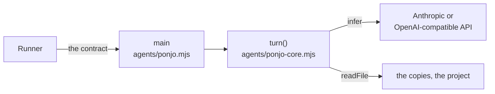

# Ponjo Agent

An agent of our own, run like Claude Code and Codex: a script in
`agents/` under the same [contract](agent-config.md#the-contract). Inside,
an LLM reads and proposes; the program checks and applies.

Claude Code and Codex are black boxes (their prompts, shell and web tools,
permissions, start-up time) for work that is narrow: read, comment, edit
text. Our own loop for only that is small enough to read whole, and runs a
cloud model of your choice. Local models are not a goal for now: the ones a
laptop runs (an 8B model tried) claim edits they did not make.

## Principles

1. **Read and propose, never write.** The model's only effect is a
   proposal; the program checks it and applies it to the copies.
2. **The tools are the permissions.** `read`, `find`, `grep`, `comment`, `resolve` and `propose` only, and
   with Anthropic, its web fetch and the MCP tools the user names: no shell, no network but the model's
   API. Text a teammate wrote can at worst make an undoable proposal, or call those MCP tools.
3. **Stateless.** A turn remembers nothing after. Within it, all state is
   the messages, and its trace replays it.
4. **The doc comes with the prompt; the model asks for the rest.** Nearly
   every turn needs the doc, so it is sent, not read: a step saved. The
   project's file names come too, as a person sees them in the sidebar;
   the model reads what else it needs.
5. **Read by line number, write by quote.** Never count characters.

## Interfaces

| Interface | Called by |
| --- | --- |
| `turn({ prompt, doc, sidecar, thread }, { infer, readFile, resolve }) → { doc, sidecar, reply }` | the program's `main`; the preview's buddies (`preview/doc-stub.js`) |
| `infer(messages, tools) → { calls: [{ id, name, args }], text, sent, usage }` | `turn`, for each step |
| `read`, `find`, `grep`, `comment`, `resolve`, `propose` | the model, as tools |

**`main`** is all the I/O, and all of the contract: it reads the prompt on
stdin, the paths in `PONJO_DOC`, `PONJO_COMMENTS` and `PONJO_PROJECT`,
the thread in `PONJO_THREAD` and its settings in `PONJO_SETTING_*`, calls `turn`, writes the texts it
gives back to the copies, prints the reply and exits 0. A run without a key fails at once,
saying where to set it.

**`turn`** is one buddy answering one thread, with no I/O of its own: it
thinks, and checks what it proposes. `prompt` is stdin as is; `doc` and
`sidecar` are the copies' paths in the project, and `resolve` puts a path
the model wrote in that form. It gives back the copies' new texts and the
reply, checked once, and throws when the turn fails. It
and each `infer` are in `ponjo-core.mjs`, which imports nothing, so a
browser runs them too; `main` and `readFile` are in `ponjo.mjs`.

**Paths are the project's only**, as a person in it would write them:
relative to its top, `/` between folders. An absolute path, or one out of
the project, is no file, so a turn's trace never shows where a run keeps
its copies or where the project is. `main` finds the copies' paths in the
project from where they sit in the working folder.

**`readFile(path)`** gives a file's text, a folder's entries (a subfolder's
ending in `/`), or null, and is all the turn can see: the copies, and the
project's files as the app shows them (inside the folder, not starting with
`.`, sidecars included), and of files only text (no NUL byte) of 20 MB or
less; in doc mode, the working folder, which holds only the copies. It reads
the project folder itself, so it is the boundary: what it refuses, no
teammate's comment can get a buddy to read. Tests run one table of cases on
it and on the app's ProjectService, so the two cannot drift.

**`infer`** is one step of the model, one implementation per provider,
over plain HTTP (the program runs from the config folder, with no
dependencies). `turn` keeps the messages in one neutral form (the prompt,
each step's calls with the model's message as its API sent it, and each
call's result), and each `infer` translates them:

| `provider` | API | Its own |
| --- | --- | --- |
| `anthropic` | Messages (`/v1/messages`) | `output_config.effort`, the model thinking as it needs; its messages sent back as they came, thinking included; prompt caching up to the last message, moved each step, so a step pays in full only for what is new; web fetch, with `web`; an MCP server's tools, with `mcp_url` and `mcp_tools`; a refusal or a cut-off answer fails the turn |
| `openai` | Chat Completions at `endpoint` (OpenAI, OpenRouter and others) | `reasoning_effort`; caching is the API's own |
| `nebius` | Chat Completions at Nebius Token Factory, for NVIDIA's Nemotron models | no effort |

All send `tool_choice: "auto"`, the same for every model: current Claude
models refuse a forced tool call, and Nemotron, forced, answered a question
with `comment`. A step without one is the model's answer, as for any agent:
its `text` is the reply.

A request that failed where the server most likely did no work is sent once
more, the same body, after its `retry-after` (at most 60 seconds) or 5
seconds: a 429, 503 or 529, or a connection refused or reset before any
answer. A repeat is safe: a request has no effect but its answer, a step is
added to the messages only once its answer arrives, and nothing touches the
copies before a valid `propose`; a duplicate costs only tokens. Anything
else fails the turn: a 500 may fail the same way again, a name that does not
resolve is a wrong endpoint, and a timeout has already waited (Node's
`fetch` gives up on a reply that takes five minutes to start).

**`read({ path, lines? })`** returns the text with line numbers, from line
`lines[0]` to `lines[1]`. A file over 20,000 characters without `lines`
returns its outline instead (Markdown headings with their line ranges); a
folder, its files. When the doc's folder has a file by the same path, it says
so: models read a file a comment names from the project's top, though the
prompt says it is from the doc's folder.

**`find({ pattern, path? })`** returns the paths of the files under the
folder `path` (the project's top if left out) that `pattern` matches, sorted.
`pattern` is a JavaScript regular expression, not a glob, matched against
each path in the project; as in the sidebar's filter, case is ignored unless
it has a capital letter. An invalid one says what is wrong and that it is not
a glob.

**`grep({ pattern, path? })`** searches the lines of the files under `path`,
a folder or a file, with the same pattern: each file's path, then each line
it matches as `read` gives it, cut at 500 characters. Both walk the folders
with `readFile`, and give at most 100 paths or lines, then how many more,
saying to narrow the pattern or the path.

**`comment({ on, body })`** starts a thread on `on`, quoted from the doc
as the edits leave it and found there once, or `""` for the whole doc; **`resolve()`** resolves
the thread the turn answers. Each says at once whether it took, and its
line of the sidecar ([agent config](agent-config.md#comments)) is written
by the program and added with the proposal. Their own tools, as a member's
own actions, and not fields of `propose`: a model writing those lines
itself got the path, the JSON or the thread's id wrong, and one filling a
`resolve` field of its last call resolved each thread it had done what was
asked in. A comment's text is found as the app finds it: as quoted, else
with any run of whitespace standing for another, and only once, in the doc
as the edits leave it. So a comment may quote text the edits write: one not
in the doc yet says so, and one found more than once is not added. When the
turn ends its texts are checked again: one the edits change, repeat or never
write would quietly be on the whole doc, so it is taken back and the turn
sent back, saying to comment again.

**Web pages**, with Anthropic and `web` on: Anthropic's web fetch
(`web_fetch_20260209`), which runs at Anthropic, not on this computer, so it
cannot reach the user's own network. It opens only a URL already in the
messages: one in the thread or the doc, or on a page it read. So it can send
nothing out of the doc but which of those links it follows, and a page's
text, like a doc's, can at worst make an undoable proposal. It is the API's
own tool, not one of `turn`'s: a step that fetches comes back with the page
read, and its reply is the text after the last page. A step Anthropic pauses
while fetching is asked to go on, as one answer, at most five requests.

**MCP tools**, with Anthropic, `mcp_url` and `mcp_tools` set: the tools
named in `mcp_tools`, and only those, of the remote MCP server at
`mcp_url`, called by Anthropic's MCP connector (beta
`mcp-client-2025-11-20`) with `mcp_token`, which goes to Anthropic with
each request. Like web fetch, the API's own tools: a step comes back with
their results, its reply the text after the last, and goes on when paused.
One server, reached from Anthropic, so only one on the internet; with a
token of the user's, as the connector has no sign-in. Ponjo cannot tell
which tools only read: the user names them, so names only those. They act
with the user's token for whoever asked, a teammate who can edit too, and
what they read can land in a doc teammates read.

**`propose({ edits: [{ old, new }], reply })`** ends the turn. The edits
change the doc only: `old` must be found in it exactly once. One bad edit
sends the whole proposal back, saying what to fix. `reply` is printed, and
may be empty. It runs after the other calls of its step, so a comment sent
with it is in. In a step that also reads, or with another `propose`, it is
not run, and says so: it was written before the model saw what the reads
return.

## The loop

```
step(messages, budget):
  calls = infer(messages, tools)
  if there are none: return the texts with the comments, and its text as
    the reply
  run each call in order, a propose last, and only one in a step with no
    read, find or grep; a valid one: return the texts, and its reply
  if budget is 0: fail
  return step(messages + calls + their results, budget - 1)
```

The first message is the prompt, as is: its rules are every agent's. Then,
in a project, its files as the sidebar shows them (no sidecar of a file
there), so the model knows which docs a comment can mean: every path up to
200, else the top folder's entries, saying to find the rest. Then the doc
as `read` gives it: with line numbers, or its outline when it is over
20,000 characters. The
tools match the contract it describes: `propose` edits the doc, `comment`
and `resolve` are its tools to comment and resolve, and the reply is what
the prompt says to print. Twenty steps, and the turn fails.

## Architecture



- **Shipped, then the user's,** like the other scripts: theirs to read,
  change, or rewrite in any language that keeps the contract.
- **Its settings** are in its [manifest](agent-config.md#agents), not in
  the program. Each provider keeps its own model and key, shown while it is
  picked, so switching back and forth sets nothing again:

| Key | Type | Default |
| --- | --- | --- |
| `provider` | choice: Anthropic, OpenAI-compatible, Nebius Token Factory | `anthropic` |
| `endpoint` | text, for OpenAI-compatible only | `https://api.openai.com/v1` |
| `<provider>_model` | text, one for each provider | Anthropic `claude-opus-5-5`, OpenAI-compatible none, Nebius `nvidia/nemotron-3-super-120b-a12b` |
| `<provider>_key` | secret, one for each provider | none: a run without the picked provider's fails, saying where to set it |
| `web` | switch, for Anthropic only | on: the model reads web pages (see Web pages) |
| `mcp_url`, `mcp_token`, `mcp_tools` | text, secret, text, for Anthropic only | none: no MCP tools (see MCP tools); `mcp_tools` the tools' names, comma-separated |
| `effort` | choice: low, medium, high | `low`: scoped edits; higher thinks longer before it answers |

- **Tests** call `turn` with a fake `infer`, and each `infer` on a fake
  server of its API. The program's check of a comment's text and the
  app's (`src/core/comments.js`) run on one table of cases, so they
  cannot drift apart: the program runs from the config folder and cannot
  import it.
- **The benchmark** (`npm run bench:agent`, on your own key, not in CI)
  runs each case of `scripts/bench-cases.js` a few times on a real model,
  under the contract, and checks what it left: a doc and a thread asking
  Clippy (a question, an instruction, an unclear ask, comments to add, a
  thread to resolve, a doc that tries to give orders, a comment that means
  another file in the project). Each check passes
  right answers and fails wrong ones in `npm test`, without a model; a run
  that fails on the API counts as neither. A failed run's folder and trace
  are kept to read: a model's mistake, or a check's, which then gets that
  answer as a test.
- **Each turn's messages go to its trace** (`PONJO_TRACE`, [agent
  config](agent-config.md#traces)), a line each as they come, but the
  prompt, which the app has: the model's with how long it took and its
  `usage`, each call's result after it. The app keeps them only while
  Trace runs is on.

## Open questions

- A step waits for the whole answer, at most 16,000 tokens, with no
  streaming: Node's `fetch` gives up on a reply that takes over five
  minutes to start, which a high effort could reach.
- No fallback model when Anthropic's safeguards refuse: the turn fails,
  saying so.
- Later: web pages with the other providers, by a fetch of our own that
  keeps, as Anthropic's does, to the links in the messages and off the
  user's network.
- MCP tools only in a turn the owner asked for: a teammate can now use the
  owner's token. Also: more than one server, a server that needs a sign-in
  (OAuth), and the other providers.
