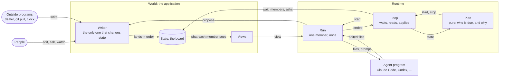

# Blackboard Agent Runtime

**People and a team of agents watch the same board and improve it together.
When the board changes, the runtime works out who is due and runs them;
each agent decides whether to act, and the board's writer decides what
lands.**

*Terms.* A **member** is a person or an **agent** (an AI member: an identity
and a prompt). An **agent program** is the tool that does an agent's
thinking, such as Claude Code. A **world** is what the board holds and its
rules: a doc, a poker table, an incident.

## The problem

Today you delegate to an agent: hand off a task, wait, review the result.
That works for one agent and one task. It fails when the work is shared: a
poker table with you and three agents, or a doc that people and agents
improve at once. There, nobody hands work back; everyone watches one state,
and anyone may act at any moment.

Delegate runtimes start a run per event, so a lost event loses the work:
even OpenHands [drops requests](https://github.com/OpenHands/extensions/blob/cfd1d0f873c0d97e0a1c30093b34c6364a1141c0/skills/github-repo-monitor/scripts/main.py#L1012-L1042)
when a poll fails. And each agent acts on its own private context, so
parallel agents are kept apart on branches and merged by hand.

## Four principles

**1. Decide from state, never from events.** The runtime works out who is
due from what the board holds. An event only means "look again", so a lost
event or a restart costs nothing. Agents remember nothing between runs, so
they can't drift from the board.

**2. Agents propose; only the writer changes state.** A run reads its
member's view and hands back a proposal. It changes nothing itself, so it
can be stopped, refused and redone, or lost, at no cost.

**3. Mechanism in the runtime, policy in the world.** The runtime decides
when to run whom. The world decides what each member sees and what lands: a
doc merges edits, a poker table refuses a stale raise. Private views follow:
a member is handed only its view, and woken only when that view changes.

**4. People declare; agents reconcile.** Only people say what they want: a
request, a watch, a standing intent. Agents work the board toward it, and
when it is met, the board comes to rest. Chains between agents are capped,
and agents that keep undoing each other are stopped for a person to settle.
Today's intents are narrow because agents are costly; they widen as agents
get cheaper and more reliable.

## Architecture



| Component | What it does | Principle |
|---|---|---|
| State | the board: the one source of truth | 1 |
| Writer | the only thing that changes state; lands proposals in order, or refuses them under the world's rules | 2, 3 |
| Views | what each member may see, people and agents alike | 3 |
| Loop | waits until the world changes, reads its state, applies the plan; takes no callbacks | 1 |
| Plan | a pure function from state to "start these, stop those, and why"; every rule and limit lives here | 1, 4 |
| Run | one member, once: its view in, the agent program in between, a proposal out | 2 |
| Agent program | does the thinking; files in, files out | 2 |
| People | declare what they want, and edit like anyone else | 4 |
| Outside programs | change the world through the writer, like anyone else | 1 |

The runtime asks a world five questions, and nothing else:

```
members()                       who is here
asks()                          who was asked and hasn't answered
view(member, { since, asks })   what this member sees: files, a prompt, a version
wait(version, deadline)         block until something changed after this version, and say who changed it
propose(member, version, old, new)   does this land? "landed", or "refused, because..."
```

**How a change moves**, at a poker table:

1. The dealer writes "Action on: Bob". The writer lands it as version 41.
2. The loop, waiting on version 40, wakes and reads the state.
3. The plan sees that Bob's view changed and Bob is due; nobody else's view
   changed.
4. A run hands Bob's view to the agent program, which decides to call.
5. The run proposes the call. The writer checks that it is still Bob's
   turn, and lands it as version 42.
6. The loop wakes again. The dealer's next move changes Alice's view, so
   Alice is due.

Nobody drew that flow: each step is the plan reading a new state.

## What emerges

- **Always-on with no jobs.** Agents act when the world changes, whoever
  changed it; when nothing changes, nothing runs.
- **Parallel work on one board,** with no branches.
- **Coordination with no orchestrator.** Bob acts, the board changes, so
  Alice is due.

## Evidence

Open-card Hold'em on Ponjo's real runtime, with scripted agents, lost no
actions. Small fixes that follow from these principles took it from 3.4 runs
and 5.2 s per action to 1 run and 0.25 s. The [poker page](https://ponjo.app/poker.html),
three AI players and you at one table, was built from scratch with its own
small runtime (`preview/poker-runtime.js`) and arrived at the same shape: a
pure plan, one view that hides others' cards, a writer that refuses stale
moves, and table talk limited by depth.

## Not for

Fixed flows that split into independent tasks and need only a final answer.
An orchestrator fits those better.

## Status

- **Built** for docs, in Ponjo: deciding from state with a pure plan, one
  writer, requests and watches, stateless agents, the agent log, and the
  poker fixes (outside writes wake at once and end no run; wake lines; an
  agent may ask another, for a step).
- **Built** for poker, in its own page: per-member views, refusals, chains
  limited by depth.
- **Proposed** for Ponjo's runtime: the five-question world interface;
  refusals; depth and a spending breaker in place of steps; a host that
  keeps running with no window open. What differs today:
  [agent runtime](agent-runtime.md#today).
- **Not yet:** agent programs can still act outside the board on their own;
  actions on the outside world should become proposals too.
- **Then, in worlds:** per-member views in the doc world; the poker table
  as a world on Ponjo's runtime.
