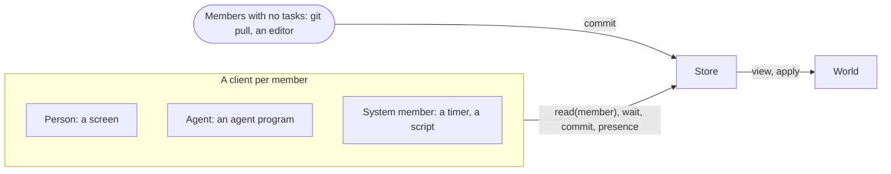

# Blackboard Agent Runtime

A runtime for worlds where people and AI agents act on one shared state.
Part 1 is a world of members, with no LLM in it: any multi-user
application has this shape. Part 2 is what an agent adds. Why it is built
this way: [vision](vision.md). Ponjo is one host ([Ponjo](#ponjo)).

## Words

| Word | Means |
| --- | --- |
| member | one who acts in a world: a person, an agent, or a system member (the clock, a dealer) |
| client | what acts for a member: a controller and a program |
| program | what a controller hands tasks to: a person's screen, an agent program, a script, a timer |
| seat | whom a change acts as (`as`): a member, or a role it plays; the world gives a seat its view and rights |
| owner | the person whose keys and money an agent uses; each agent has one |
| wallet | the owner's part: whom they pay for, how much, the limits, the keys, the effects; kept where the owner trusts |
| host | the application that runs one owner's clients |
| store | where the state is kept, and the one way it changes |
| world | the rules: two pure functions |
| task | one thing a member is due to do: one `given`, as one seat |
| run | an agent program working once, on one or more tasks of one seat |
| effect | an action on the outside world (a message, a deploy), carried out by the wallet |
| presence | who is here and what they are doing; not part of the state |

# Part 1. A world of members

Nothing in this part knows what an agent is. A person and an agent read
the same view and act by the same actions, through the same writer; only
their programs differ.



## Members

A member is an identity and a client. A person, a buddy acting as itself,
an agent playing a person's seat while they are away, the clock and a
dealer are the same thing with different programs. A member acts in two
ways:

- **On a task**, through its controller: what its view says it is due to
  do (its turn, an ask, a deadline).
- **Of its own accord**, with no task: a person types, chats, resolves a
  thread; `git pull` writes a file. An agent never does: every look costs.

## Store

```
read(member)              → { rev, view }     that member's projection: the world's view
wait(member, rev)         → rev               once that member's view has changed after rev
commit(change)            → { rev, effects } | { refused: why }
presence(member, what)                        what the member is doing now, shown as the view says
```

A change:

```
Change  { by, at, as, base, answers, body }
```

`by` and `at` the store sets; `as` the seat it acts as; `base` what it was
made on (a turn, a text's hash, a rev); `answers` the ids of the tasks it
answers; `body` the world's.

- **It alone holds the whole state.** A client, a person's or an agent's,
  on this machine or another, gets only its projection. The host that runs
  the store can read everything; no one else can.
- **It keeps the state.** `{ rev, state }` outlives a refresh, a restart or
  a crash; `rev` only grows. A store that forgets is not a store. Two copies
  of one truth, such as a folder synced by git, are not one store: each is
  the other's outside writer.
- **It authenticates.** `commit` sets `by` from who sent the change, never
  from the change. A file written outside is `by: outside`, so it vouches
  for nothing.
- **It stamps.** `commit` sets `at` from the store's clock.
- **It lands one change at a time.** It applies the world's `apply` to the
  newest state and keeps the result only if nothing landed meanwhile; else
  it applies again. `base` tells `apply` whether the change is stale.
- **It wakes only whom a change concerns.** `wait` returns when that
  member's view has changed, as its fingerprint tells. Its return carries
  nothing: the client reads again, so a lost or doubled notice costs
  nothing, and no one learns of a change they may not see.
- **It keeps the past by content.** What a view or `apply` needs of an
  earlier state (what changed since a member last answered; the edits a
  late change must move over) is looked up by hash. Tasks never need it:
  they come from the state alone, so two stores that kept different pasts
  give the same tasks. A past no longer kept is a first look.

*Why one holder.* Hidden information (a hand of cards, a role) is safe
only if no client ever holds the whole state. One holder, and projections
for everyone else, is the simplest way; a holder that plays in no seat (a
server) is the same store, moved.

## World

```
view(state, member, past)    → { content, actions, tasks, seen, rules }
apply(state, change, past)   → { state, effects } | { refused: why }
```

Both are pure: no I/O, no clock, no randomness of their own. What comes
from outside comes in a change: a shuffled deck in the dealer's, the time
in the store's stamp, a deadline in the clock's.

### view

| Field | Is | A screen shows | An agent gets |
| --- | --- | --- | --- |
| `content` | what the member may see, as data | the page | text, or files |
| `actions` | what it may do now: `{ name, input, about }` | buttons, forms | tools |
| `tasks` | what it is due to do | its inbox, "your turn" | what its run is for |
| `seen` | whose presence it may see | cursors, "typing" | who is at work |
| `rules` | how the world works, in words | the help | the system prompt |

A view is the seat's. What a seat may see and do is the world's to say
(a wolf sees the pack; a doc's reader its threads). One `view` serves a
person's screen, an agent's prompt and another host alike, so they never
disagree. A seat's view goes only to a machine whose owner may see it.

### Tasks

```
Task  { given, as, kind, from, depth, at?, why }
```

`given` the one id it answers; `as` the seat; `kind` `turn` (the rules
ask it), `ask` (a member asked) or `watch` (a standing request); `from`
the people whose changes set it off, empty when the rules alone did; `depth`
counted from the change that set it off, whatever the kind: 0 for a
person's or the world's own, one more than an agent's; `at` when it is due
by; `why` in words.

- Tasks come from the state alone: who must act, who asked whom, who
  turned on a watch. A `watch` task's `given` names the watch and what it
  last saw, so any answer to it, a failed one too, moves it on, and only a
  later change makes a new one. Each fact is a change whose `by` the store set, so a
  task names only people who really asked.
- The order of `tasks` is the world's priority.
- Where one answer is wanted from several (a line said to the whole
  table), the world lists the task for one member, by a rule of the state.
- **A task that holds up a person has an `at`:** a turn they cannot play
  until it is answered. A system member, which acts at once, needs none.
  The rules decide what happens when it passes. A task that holds no one
  up, such as an ask, needs none either: its run, if it hangs, fails at
  the run's timeout.

### Answers

A change answers the tasks in `answers`. Every world gets one ledger,
kept in the state by a pure wrapper around its `apply`:

| A run's change | The ledger | The task |
| --- | --- | --- |
| accepted, whole or in part | answered | gone |
| refused by `apply` | a try, and why, shown in the seat's next view | due again; at the world's limit of tries, its `fallback` |
| `{ failed }`, or not started by the wallet | failed | `turn`: its `fallback` at once; `ask`: gone, a person may ask again; `watch`: gone until its view changes |
| nothing | answered | `turn`: its `fallback` at once; `ask`, `watch`: gone |

`apply` may land part of a change and drop what no longer applies (a
reply in a thread resolved meanwhile). A refused run still writes the
ledger: that write takes a `rev`, and
wakes only the seat whose view it changes. A world gives only `apply`,
`fallback(state, task)` and its limit of tries. A person's or an outside member's refused change lands nothing:
they see why at once. Answers are in the state, keyed by `given`, never by
`rev`, so a restart, or another host on the same state, finds the same
tasks.

### Time

The clock is a member. Its tasks are the world's deadlines: a turn's `at`,
a pause that settles people's typing, a narrator's next call. Its program
waits until each `at` and commits the change the task names, with its
base, so it lands only if still due. No rule reads a clock.

### Disagreement

Open: how the world sees the agents of different people undo each other,
so that it stops listing those tasks and gives the people one to settle
it. Until then, the wallet's limits are all that stop them.

## Controllers

One per member, on its owner's host:

```
client(member, program):
  forever:
    { rev, view } = store.read(member)
    stop the run going if none of its tasks is in view.tasks
    hand view.tasks to program                  a person's: all; an agent's: Part 2
    wait until store.wait(member, rev) returns
```

- A run goes on while any of its tasks is still listed. What the program
  returns is one change, committed at once. A run that is stopped commits
  nothing; its tasks are handed again when they are due again.
- A person's program shows every task and returns when they act; stopped,
  it takes the prompt away and keeps what they had written.
- A controller holds only what is going. Losing it loses at most that.

*Why a controller per member.* The member is what acts. One per member puts
each on its owner's host, lets one wait or hang without holding up
another, and makes a person, an agent and the clock the same loop.

## Presence

Who is here, who is typing, who is thinking: told to the store with
`presence`, shown to those the view's `seen` allows, kept nowhere. It is
not state, so it decides nothing; a member that watches it may commit a
change (a player gone too long leaves their seat). It can say what the
state hides (a seat at work at night has a role), so the world decides who
sees it. A screen may type a fresh line out: the line has landed.

# Part 2. Agent clients

An agent is a member whose program is an agent program. Four things are
its own: each look costs money; it acts for others; it fails in ways a
person does not; it remembers nothing between runs.

```
agent client = controller + renderer + agent program, with the owner's wallet and the host's capacity
```

An agent's controller takes the tasks of one seat that the wallet lets
start, in the view's order, and hands them to one run; it starts no other
run until that one ends. A run's answer is one change, so it lands whole.

## Renderers

The same view, written for an agent:

- **Tools**: `content` and `rules` as the prompt, `actions` as the tools it
  may call, `tasks` as what this run is for.
- **Files**, for a command-line agent program: `content` as files in a
  private folder; after the run, what it changed is turned back into
  actions.

What a run answers is one change: its actions, its thinking, or nothing.

## Wallet

What only the owner says, kept where they trust: their own machine, or a
store that holds it apart from the state, for them alone.

```
allow(tasks)     → those the owner lets start
charge(run)      → counts a run against what it spends, before it starts
carry(effects)   → each effect that landed: approved, carried out once
```

- **For whom.** The owner always pays. Their policy says for which people
  in `from` they let a task start (the room, the team, themselves).
- **How much.** A quota per person: a run's cost is charged evenly to the
  `from` of the tasks it answers; a task with no `from` (a turn the rules
  set) to the owner's own budget.
- **Runaway.** Past a depth limit, nothing starts, so agents waking each
  other come to rest. Past N runs on `watch` tasks, or of `depth` above 0,
  since a person last acted in what this agent sees, none starts until one
  does or the owner resumes: a loop the depth cannot see, such as a
  program that echoes an agent, stops too. A `turn` is not counted: the
  rules bring a game to its end.
- **Keys, settings, and each effect's record.**

A task the wallet will not start is answered as not started (Answers): a
turn others wait on is played by its fallback, not left hanging.

*Why apart from the state.* The store says who did what. Only the owner
says what they will pay for, and only where they trust are their keys.

*Where it runs.* An agent's client runs where its wallet is, and is handed
its seat's view. So where the owner may not see that view (a seat in a
game of hidden hands), the client and the wallet must sit beside the
store: the store keeps that owner's wallet apart from the state, and no
client ever reads it.

## Capacity

A provider's limits (requests or tokens a minute, a 429) are the host's,
not the world's:

- One queue per provider and key, shared by every controller on the host.
- Within a world, in the order of its tasks; across worlds, a task a
  person waits on (a `turn`, an `ask`) first, then each world in turn.
- Waiting is never failing: it is not an answer, not counted by the limits
  above, and not timed by the run's timeout. A task that is no longer due
  stops its run, waiting or not.
- Only an error that waiting cannot outlast (a bad key, a missing model, a
  500 that repeats) is `{ failed }`.
- Only calls made through the host are queued. An agent program that calls
  its provider itself, such as a command-line agent, waits on its own, and
  its waiting counts in the run's time.

## Effects

An effect (a message, a call to an API, a deploy) is part of a run's
change, never something a run does itself.

- **Proposed.** A run lists its effects in its change, each with a name, an
  input and an id. Only effects the owner installed can be named; the
  prompt lists them. Nothing in the store can install one.
- **Carried out once, after it lands.** `apply` returns the effects of a
  change that landed, and the wallet carries them out. They are in the
  landed change, so the wallet, after a crash, finds each one it has no
  record of and goes on; its record (approved, started, done or failed) is
  the wallet's, never the state's.
- **Never twice on its own.** One that started and did not end shows as
  "may have run", with Retry for a person. It is given its id, so a service
  that takes an idempotency key drops a second try.
- **Approved first.** Each asks the owner, by default: a prompt from the
  wallet to its owner, not a task of the world. The owner may let an effect
  run unasked, and then only for tasks whose `from` is them alone.
- **Its result** is committed as the effect's reply, one deeper than the
  run that proposed it.
- **Not undone.** Undo takes back the edits it came with, never the effect.

## Security

- The store sets who made each change; a file written outside vouches for
  no one.
- A run acts with its seat's rights (`as`), and starts only for people the
  owner pays for.
- No client holds the whole state, and a seat's view reaches no machine
  whose owner may not see it.
- An owner's key spends only what their wallet allows; a wallet kept in a
  shared store has its own budget and rate, so a room cannot spend more
  than its owner set.
- **Influence follows the view.** A run reads what others wrote, and that
  text can try to steer it. What bounds the harm: its seat's rights, the
  owner's approval of each effect, and a change that shows who made it and
  can be undone. Nothing stops the attempt.
- **Reading can leak.** What an agent program reads can end up where others
  see it, and a fetch can carry data out in its URL. Where a view holds
  what others must not learn, the agent gets the world's actions as its
  only tools.

# Hosts

## Ponjo

Ponjo, a text editor where people and buddies co-author files, is a host.
Its rules for a doc: [host spec](../app/host-spec.md#buddies); what an
agent program gets and returns: [agent config](../app/agent-config.md).
How each of its worlds implements this: [doc](../app/worlds/doc.md),
[poker](../app/worlds/poker.md), [werewolf](../app/worlds/werewolf.md),
[spy](../app/worlds/spy.md); the games' tables:
[rooms](../app/worlds/rooms.md).

| Here | In Ponjo |
| --- | --- |
| agent | a buddy |
| agent program | an agent (`agents/`, run by `src/host/runner.js`) |
| world | the doc world (`src/host/doc-world.js`); three games in `preview/` |
| store | the doc's door (`src/host/doc-service.js`); for a game, a [room](../app/worlds/rooms.md) on the relay, holding a store in memory (`src/core/store.js`) |
| answers | the ledger, a wrapper around a world (`src/core/ledger.js`) |
| wallet | the config folder: settings, secrets, logs; for a game, the room, for the key's owner |
| controller | `src/core/controller.js`, with the wallet's limits and the clock's program; the doc's, `src/core/runtime.js`, given its runs, logs and settings by `src/host/buddy-runtime.js` |
| an effect | a plugin in `actions/` of the config folder; its input on stdin, its id as `PONJO_ACTION_ID`, its record in `logs/actions.jsonl` |

Open: Ponjo's limits. Proposed: a depth limit of 10, and N = 30.

## Today

Who's the Spy runs on this design's core (`src/core/store.js`,
`ledger.js`, `controller.js`), with its store in the opener's page
([spy](../app/worlds/spy.md#today)). The doc, poker and werewolf follow
the design before this one:

- The world is one object of five calls with I/O (`members`, `asks`,
  `view`, `wait`, `propose`), and the doc's sixth, `failed`; who is due is
  the runtime's plan (`src/core/due.js`); a controller reads the whole state.
- One controller per open doc or game, for all its agents; people have
  none, and each game writes its own "your turn" and its own view for
  people (poker's `share`).
- Who is due rests on notes in memory. In a game, a run that makes nothing
  or fails commits nothing, and a failed run waits for Retry, in memory; the
  doc answers each ask with a comment instead. Each game keeps its own
  tries and fallback.
- The doc's `rev` starts again each time it opens; the comments are read
  from disk beside the door; a run lands in several commits.
- A game's table lives only in the memory of the page that opened it: a
  refresh ends the game, and that page can read every card. Spy's is kept
  in that page's storage, so a refresh goes on with it; that page can read
  every word.
- Time is in page timers and in `stamp()`; tables change in place.
- The breaker counts runs in a window; the depth limit is 1,000; a busy
  API fails a run after one retry ([Ponjo agent](../app/ponjo-agent.md));
  runs share no queue. Spy's wallet has the proposed limits, in its page.
- The ledger hands `fallback` the change's `at` as well, which spy needs to
  time the next turn from.

## Migration

How Ponjo's code gets there, in six steps, each with its tests and its
design gate: [runtime migration](../app/runtime-migration.md).
