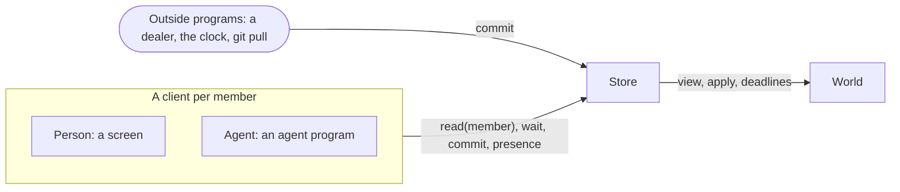

# Blackboard Agent Runtime

A runtime for worlds where people and AI agents act on one shared state.
Part 1 is a world of members, with no LLM in it: any multi-user
application has this shape. Part 2 is what an agent adds. Why it is built
this way: [vision](vision.md). Ponjo is one host ([Ponjo](#ponjo)).

## Words

| Word | Means |
| --- | --- |
| member | one who acts in a world: a person or an agent |
| client | what acts for a member: a controller and a program |
| program | what a controller hands a task to: a person's screen, an agent program, a script |
| seat | whom a change acts as (`as`): a member, or a role it plays; the world gives a seat its view and rights |
| `for` | the people a task is done for: whose trust and money it spends |
| owner | the person whose machine, keys and money an agent uses; each agent has one |
| host | the application that runs one owner's clients |
| store | where the state is kept, and the one way it changes |
| world | the rules: three pure functions |
| task | something a member is due to do: what it answers, as whom, for whom |
| run | an agent program working once on a task |
| presence | who is here and what they are doing; not part of the state |

# Part 1. A world of members

Nothing in this part knows what an agent is. A person and an agent read
the same view and act by the same actions, through the same writer; only
their programs differ.



## Members

A member is an identity and a client. A person, a buddy that acts as
itself, and an agent playing a person's seat while they are away are the
same thing with different programs. A member acts in two ways:

- **On a task**, through its controller: what the world says it is due to
  do (its turn, an ask).
- **Of its own accord**, with no task: a person types, chats, resolves a
  thread. Only people do; an agent acts only on a task, as every look costs.

## Store

```
read(member)              → { rev, view }     that member's projection: the world's view
wait(member, rev)         → rev               once that member's view has changed after rev
commit(change)            → { rev, actions } | { refused: why }
presence(member, what)                        what the member is doing now, shown as the view says
```

- **It alone holds the whole state.** A client, a person's or an agent's,
  on this machine or another, gets only its projection. The host that runs
  the store can read everything; no one else can.
- **It keeps the state.** `{ rev, state }` outlives a refresh, a restart or
  a crash; `rev` only grows. A store that forgets is not a store.
- **It authenticates.** `commit` sets `by` from who sent the change, never
  from the change. A file written outside, such as by `git pull`, is `by:
  outside`, so it vouches for nothing.
- **It stamps.** `commit` sets `at` from the store's clock.
- **It lands one change at a time.** It applies the world's `apply` to the
  newest state and keeps the result only if nothing landed meanwhile; else
  it applies again. So `{ refused }` comes only from `apply`.
- **It wakes only whom a change concerns.** `wait` returns when that
  member's view has changed. Its return carries nothing: the client reads
  again, so a lost or doubled notice costs nothing, and no one learns of a
  change they may not see.
- **It keeps the past by content.** What a view needs of an earlier state
  (what changed since a member last answered) is looked up by hash, and
  what a hash names never changes, so `view` stays pure.

*Why one holder.* Hidden information (a hand of cards, a role) is safe
only if no client ever holds the whole state. One holder, and projections
for everyone else, is the simplest way; a holder that plays in no seat (a
server) is the same store, moved.

## World

```
view(state, member, past)  → { content, actions, tasks, seen, rules }
apply(state, change)       → { state, actions } | { refused: why }
deadlines(state)           → [{ at, change }]
```

All three are pure: no I/O, no clock, no randomness of their own. What
comes from outside comes in a change: a shuffled deck in the dealer's,
the time in the store's stamp.

### view

| Field | Is | A screen shows | An agent gets |
| --- | --- | --- | --- |
| `content` | what the member may see, as data | the page | text, or files |
| `actions` | what it may do now: `{ name, input, about }` | buttons, forms | tools |
| `tasks` | what it is due to do | its inbox, "your turn" | what its run is for |
| `seen` | whose presence it may see | cursors, "typing" | who is at work |
| `rules` | how the world works, in words | the help | the system prompt |

A view is the seat's. What a seat may see and do is the world's to say
(a wolf sees the pack; a doc's reader its threads). One `view` serves a
person's screen, an agent's prompt and another host alike, so they never
disagree.

### Tasks

```
Task  { given, as, for, depth, at?, why }
```

`given` the ids of what it answers; `as` the seat; `for` the people it is
done for; `depth` 0 when a person or the world set it off, else one more
than the change that did; `at` when it is due by, if ever; `why` in words.

- Tasks come from the state: who must act, who asked whom, who turned on a
  watch. Each fact is a change whose `by` the store set, so a task names
  only people who really asked.
- The order of `tasks` is the world's priority.
- What different seats or rights need are different tasks; what needs the
  same seat and rights is one, whoever asked.

### Answers

Every run's change lands. `apply` records what it was given as answered,
keyed by content (an ask's id and its latest comment, a text's hash), never
by `rev`:

| A run's change | `apply` records | The task |
| --- | --- | --- |
| accepted | answered | gone |
| turned away (illegal, or the turn moved) | a try, and why, for its next view | due again; at the world's limit, the world plays its fallback |
| `{ failed }` | failed | gone; a person may ask again |
| nothing | answered | gone |

A person's or an outside program's illegal or stale change is `{ refused
}`: nothing lands, and they see why at once. Answers are in the state, so
a restart, or another host on the same state, finds the same tasks.

### Time

`deadlines` says which changes the clock must commit, and when: a turn
that expires, a pause that settles people's typing. The store's host
commits each at its `at`, with the state it was made for as its base, so
it lands only if still due. Time is a change like any; no rule reads a
clock.

### Disagreement

When the agents of different people keep undoing each other, the world
stops listing those tasks and gives the people a task to settle it.

## Controllers

One per member, on its owner's host:

```
client(member, program):
  forever:
    { rev, view } = store.read(member)
    stop a task going whose given is no longer in view.tasks
    hand view.tasks to program                  a person's: all; an agent's: see Part 2
    wait until store.wait(member, rev) returns
```

- What the program returns is one change, committed at once. A task that
  is stopped commits nothing; the world still lists it, so it is handed
  again when it is due again.
- A person's program shows every task and returns when they act; stopped,
  it takes the prompt away and keeps what they had written.
- A controller holds only what is going. Losing it loses at most that.

*Why a controller per member.* The member is what acts. One per member puts
each on its owner's host, lets one wait or hang without holding up
another, and makes a person and an agent the same loop.

## Presence

Who is here, who is typing, who is thinking: told to the store with
`presence`, shown to those the view's `seen` allows, kept nowhere. It is
not state, so it never decides anything. It can say what the state hides
(a seat at work at night has a role), so the world decides who sees it.

## Outside programs

A dealer, a narrator, the clock, `git pull`: each commits as itself. One
that holds a secret (a deck) runs beside the store or keeps it, and lets it
out only in its changes.

# Part 2. Agent clients

An agent is a member whose program is an agent program. Four things are
its own: each look costs money; it acts for others; it fails in ways a
person does not; it remembers nothing between runs.

```
agent client = controller + renderer + agent program, with local and capacity
```

## Renderers

The same view, written for an agent:

- **Tools**: `content` and `rules` as the prompt, `actions` as the tools it
  may call, `tasks` as what this run is for.
- **Files**, for a command-line agent program: `content` as files in a
  private folder; after the run, what it changed is turned back into
  actions.

What a run answers is one change: its actions, its thinking, or nothing.

## Local

What only the owner's machine says, and only it writes:

```
allow(task)    → whether the owner lets this task start
charge(task)   → counts a run against what it spends, before it starts
act(actions)   → each outside action that landed: recorded, approved, carried out once
```

- **For whom.** The owner's policy: which people in `for` it does work for
  (the room, the team).
- **How much.** Each person's budget, charged to `for`.
- **Runaway.** Past a depth limit, nothing starts, so agents waking each
  other come to rest. Past N runs in a world since a person last acted
  there, nothing starts until a person acts or resumes: a loop the depth
  cannot see, such as a program that echoes an agent, stops too.
- **Keys, settings, the record of each outside action.**

An agent's controller hands its program at most one task, the first in
`tasks` that `allow` lets start, as a run costs and its answer must be
whole. Another task waits for the next run.

*Why apart from the store.* The store says who did what. Only the owner
says what they will pay for, and only their machine holds their keys.

## Capacity

A provider's limits (requests or tokens a minute, a 429) are the host's,
not the world's:

- One queue per provider and key, shared by every controller on the host.
- Taken in the order of each task's priority.
- Waiting is never failing: it is not an answer, not counted by the limits
  above, and not timed by the run's timeout. A task that is no longer due
  stops its run, waiting or not.
- Only an error that waiting cannot outlast (a bad key, a missing model, a
  500 that repeats) is `{ failed }`.

## Outside actions

An action on the outside world (a message, a call to an API, a deploy) is
part of a run's change, never something a run does itself.

- **Proposed.** A run lists its actions among what it made, each with a
  name and an input. Only actions the owner installed can be named; the
  prompt lists them. Nothing in the store can install one.
- **Carried out once, after it lands.** `apply` returns the actions of a
  change that landed. Local gives each an id and a record (proposed,
  approved, started, then done or failed), never in the store.
- **Never twice on its own.** One that started and did not end shows as
  "may have run", with Retry for a person. It is given its id, so a service
  that takes an idempotency key drops a second try.
- **Approved first.** Each asks the owner first, by default: a task local
  gives the owner, not the world. The owner may let an action run unasked,
  and then only for tasks they alone are `for`.
- **Its result** is committed as the action's reply, one deeper than the
  run that proposed it.
- **Not undone.** Undo takes back the edits it came with, never the action.

Reading stays with the agent program: what it reads can end up where
others see it, and a fetch can carry data out in its URL. So the shipped
agent programs read, edit, search and fetch only.

## Security

- The store sets who made each change; a file written outside vouches for
  no one.
- A run acts with its seat's rights (`as`), and starts only for people the
  owner pays for (`for`).
- No client holds the whole state. Whoever runs the store's host can read
  it; a world whose players must not, needs a store that plays in no seat.
- **Influence follows the view.** A run reads what others wrote, and that
  text can try to steer it. What bounds the harm: its seat's rights, the
  owner's approval of each outside action, and a change that shows who
  made it and can be undone. Nothing stops the attempt.

# Hosts

## Ponjo

Ponjo, a text editor where people and buddies co-author files, is a host.
Its rules for a doc: [host spec](../app/host-spec.md#buddies); what an
agent program gets and returns: [agent config](../app/agent-config.md).
How each of its worlds implements this, as of the draft before this one:
[doc](../app/worlds/doc.md), [poker](../app/worlds/poker.md),
[werewolf](../app/worlds/werewolf.md), [spy](../app/worlds/spy.md).

| Here | In Ponjo |
| --- | --- |
| agent | a buddy |
| agent program | an agent (`agents/`, run by `src/host/runner.js`) |
| world | the doc world (`src/host/doc-world.js`); three games in `preview/` |
| store | the doc's door (`src/host/doc-service.js`); for a game, the page of the person who opened the table |
| local | the config folder: settings, secrets, logs |
| controller | `src/core/runtime.js`, given its runs, logs and settings by `src/host/buddy-runtime.js` |
| an outside action | a plugin in `actions/` of the config folder; its input on stdin, its id as `PONJO_ACTION_ID`, its record in `logs/actions.jsonl` |

## Today

Ponjo's code follows the design before this one:

- The world is one object of five calls with I/O (`members`, `asks`,
  `view`, `wait`, `propose`); who is due is the runtime's plan
  (`src/core/due.js`); a controller reads the whole state.
- One controller per open doc or game, for all its agents; people have
  none, and each game writes its own "your turn" and its own view for
  people (poker's `share`).
- Who is due rests on notes in memory; a run that makes nothing or fails
  commits nothing; a failure waits for Retry, in memory.
- The doc's `rev` starts again each time it opens; the comments are read
  from disk beside the door; a run lands in several commits.
- A game's table lives only in the memory of the page that opened it: a
  refresh ends the game. The way there: keep `{ rev, state }` in that
  browser's storage on each commit, then, if a game must outlive the page
  or hide everything from its opener, a store on the relay.
- Time is in page timers and in `stamp()`; tables change in place.
- The breaker counts runs in a window; a busy API fails a run after one
  retry ([Ponjo agent](../app/ponjo-agent.md)); runs share no queue.
