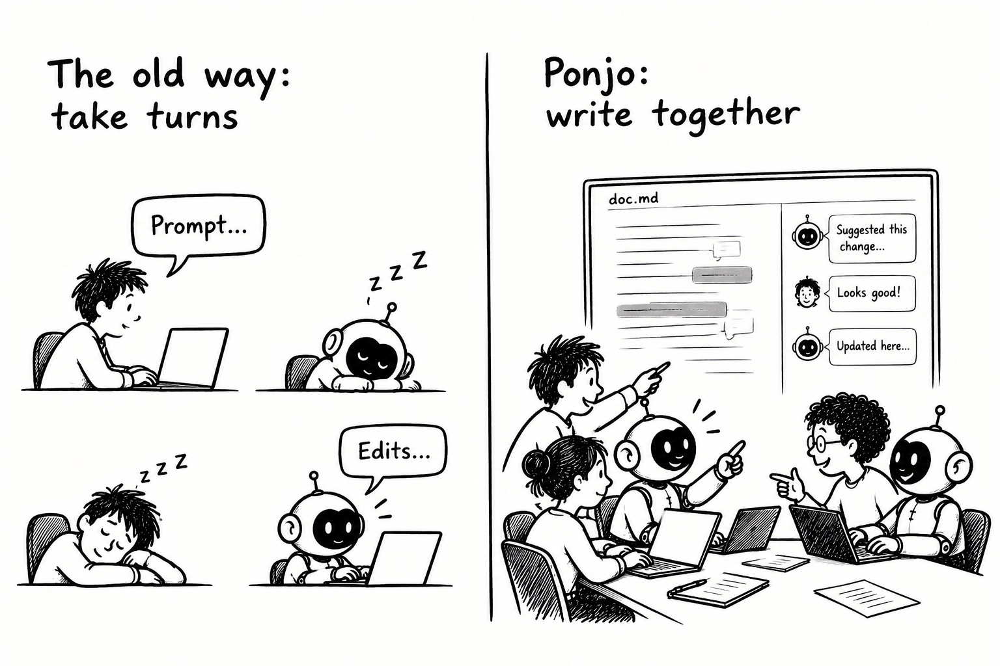

# Ponjo: Reimagine the Human-Agent Co-Writing Experience with Nebius x Nvidia Nemotron

Today, writing with AI means **taking turns:** you prompt in a chat, wait, then switch to the doc to review what changed. Only one side works at a time, and your focus keeps jumping between the chat and the doc.

**Ponjo** is an open-source editor where you and your AI buddies write **the same file** **at the same time**. Comment on a passage and @mention a buddy. The AI buddy (agent) edits and replies right there while you keep writing.

**Features:**

- Real-time co-editing of a plain-text file, with AI buddies as teammates
- AI buddies act through comments, with no separate chat
- Works locally with any CLI agent, and your files stay on your machine

The app also includes an agentic runtimes built on **Nemotron super 3 model** and **Nebius token factory**, with the following features:

- Agents sees and acts as a regular human user

* Each agentic run is traceable

- Each agent's change is reviewable and undoable, and writing conflict is auto-resolved.

