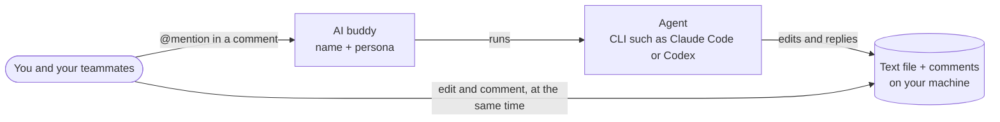

# Product Vision

People and their AI buddies write the same text files together, in real time, as one team.

## Background and Problem

Document editing is one of the most fundamental and enduring uses of computers. Human collaboration on documents has gone through two stages:

- **Sequential collaboration** (e.g., Word): User A finishes editing a Word doc and emails it to User B, who marks changes with Track Changes and comments, then sends it back to User A for review
- **Real-time co-editing** (e.g., Google Docs): User A and User B edit the same doc at the same time

Writing with AI is now inevitable, yet human–AI collaboration is still stuck in the sequential stage: a person leaves comments in the doc or in a chat box, the AI reads them and revises the doc, then hands it back. And where people already co-edit in real time, the doc lives in the vendor's cloud and the only AI in it is the vendor's.

## Our Solution

Our product puts people and AI in one real-time team, in a plain text file on your machine. The AI is no longer a tool in a chat box, but a collaborator in the doc. We call this collaborator an **AI buddy**: a name and a persona that anyone on the team @mentions in a doc, as they would a teammate. Behind each AI buddy, an **agent**, a command-line program such as Claude Code or Codex, does the work. Your **teammates**, the people you share the project with, join from a link in their browser.

People and AI buddies work on the same doc at the same time, discussing in comments and each making their own edits, just like a team reviewing a proposal together.

## Design Principles

- **People are in control**: AI buddies never take over the doc. They make only small, scoped changes to what you asked about; the app shows what each run changed, and you can undo it in one click. You decide who may resolve a thread: people by default, an AI buddy only if you allow it
- **Real-time collaboration**: No handing the doc back and forth. You, your teammates and your AI buddies edit and comment in the doc at the same time without blocking each other, and nothing a person types is lost
- **Teammates join your project**: A link opens your project in a teammate's browser, once you allow them: no install, no account, the same view you and your AI buddies have. The files stay on your machine, and each teammate edits as you do, or only reads
- **Many AI buddies, not just one**: Many personalized AI buddies see the same doc and threads the team does, act through the same edits and comments, and reply to each other in threads
- **Familiar experience**: Edit, comment and @mention, like your favorite doc collaboration app. Nothing new to learn
- **Open**: Open source, plain text files with an open comment format, and any command-line agent

## Non-Goals

- **Cloud documents**: Docs live only on your machine; no cloud storage. A shared project stays there too: the relay between you and your teammates stores nothing
- **Accounts and organizations**: A teammate joins with a link and a name; there is no sign-up, no organization and no billing
- **Proprietary document formats**: Plain text files only. Views (Markdown is the first, built in) improve co-authoring for a format; they never replace the file
- **Fine-grained permissions**: A teammate reads or edits, and is trusted; no roles, no per-doc rights, no tracking of who typed what
- **Knowledge base**: We work on a doc or a project folder, not note management
- **Chat interface**: All communication happens in comments; no chat window

## Target Users

We start with people who already write docs with AI. They:

- Want working with AI to feel as smooth as working with a human teammate, without copying and pasting between a chat box and a doc
- Mostly write locally and keep docs next to their code (e.g., READMEs and design docs in a GitHub repo)
- Often write with one or two others, a co-founder, a teammate, an editor, each with their own AI
- Value open standards and software, and don't want to be locked into a subscription service

## Core Use Cases

- **AI writes, human edits**: The AI drafts a design doc; I review it as I read and use comments to ask an AI buddy to fine-tune specific paragraphs
- **Human writes, AI edits**: I've written a 10,000-word novel. I don't want the AI making sweeping changes that mess up the whole thing, only fine-tuning a few paragraphs
- **Writing together**: On a call, two of us draft a design doc in the same file; each asks AI buddies to fill in a section while we keep typing
- **Alongside chat-based agents**: Hand big changes to a chat agent's CLI or desktop app, and make small changes by commenting directly in the doc. The page also works as a reader

## Competitive Landscape and Differentiation

Existing tools fall into four categories:

| Category | Examples | Strengths | Weaknesses |
| --- | --- | --- | --- |
| **Cloud docs with built-in AI** | Google Docs + Gemini, Notion AI, Word + Copilot | Real-time co-editing between people; agentic edits in the doc | Locked to the vendor's AI; cloud-only, proprietary format |
| **Chat AI canvases** | ChatGPT Canvas, Claude Artifacts | Generate and edit docs in a chat | Chat-centric; not local; no comment threads |
| **AI code editors and CLI agents** | Cursor, VS Code + Copilot, Claude Code | Powerful agents on local files | Built for code, not for discussing prose paragraph by paragraph |
| **Local Markdown editors** | Obsidian, Typora + AI plugins | Local, open format | AI is a plugin; no comments; no external agents |

How we're different:

- **One team, not turn-taking**: The doc stays open to everyone, people and AI buddies alike. You and your teammates keep writing while an AI buddy handles a comment, and it acts as soon as someone @s it instead of waiting for the doc to be handed over.
- **Comments are the interface**: Anyone comments, an AI buddy edits and replies in the thread, someone resolves. No switching to a chat box.
- **Local, plain text, shared from your machine**: A regular file in your repo, comments stored alongside it; teammates join through a relay that stores nothing; no subscription lock-in.
- **Any agent, many AI buddies**: Any command-line agent can plug in, and several AI buddies can work in the same doc at once. A project's AI buddies are files in the repo, so everyone who clones it gets them.

## Success Metrics

- **People in control**: The AI never takes over the doc. Measure edits that go beyond the comment's scope and the share of runs users undo.
- **Less waiting**: Measure time from an @ to the AI buddy's reply, and how long people and AI buddies wait on each other.
- **Many AI buddies**: Measure the share of docs with 2+ AI buddies and the number of AI buddy turns run once more, or not fully applied, after colliding with people's edits.
- **Writing together**: Measure the share of projects with a teammate, and characters lost when people type at once (the target is none).
- **Better writing experience**: Beat an editor + AI plugin on completion time and satisfaction for the same task; track weekly active docs and retention.
- **Open**: Docs open correctly in any text editor; count the third-party agents that connect.
